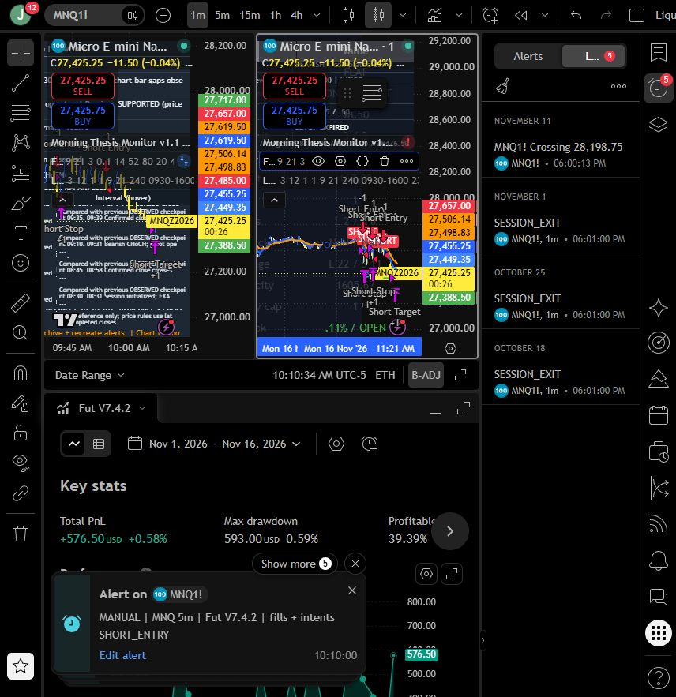
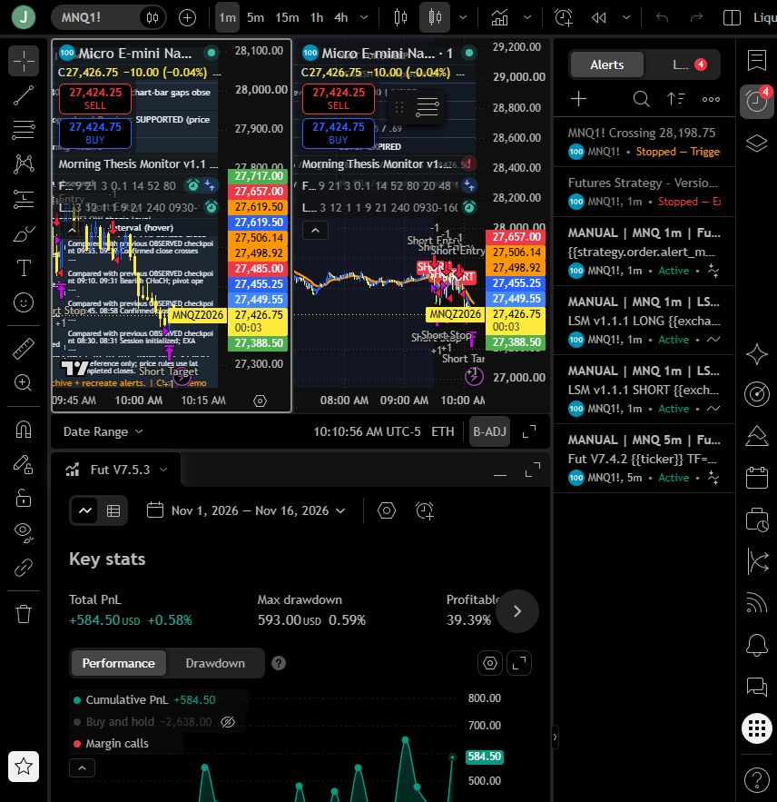
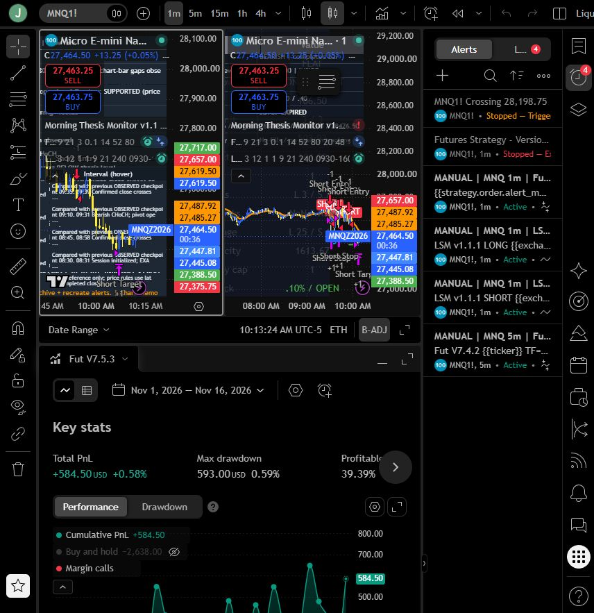
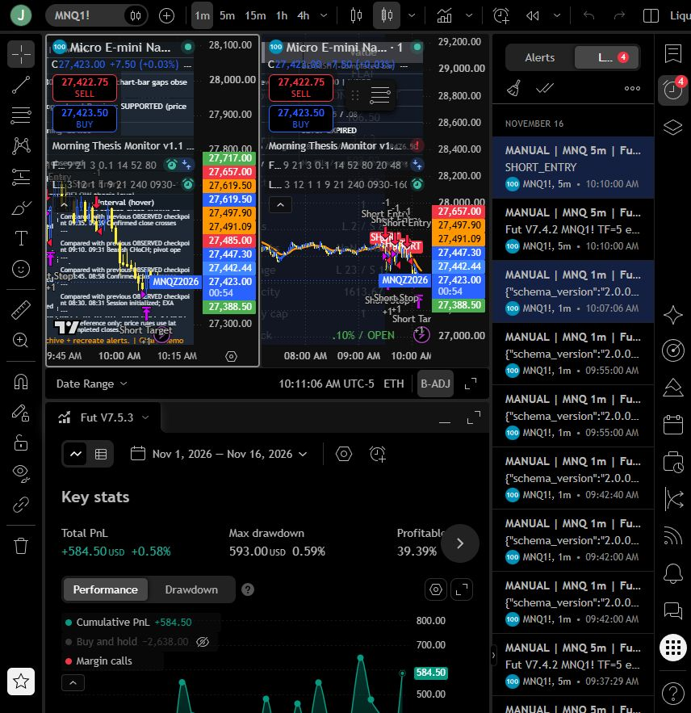
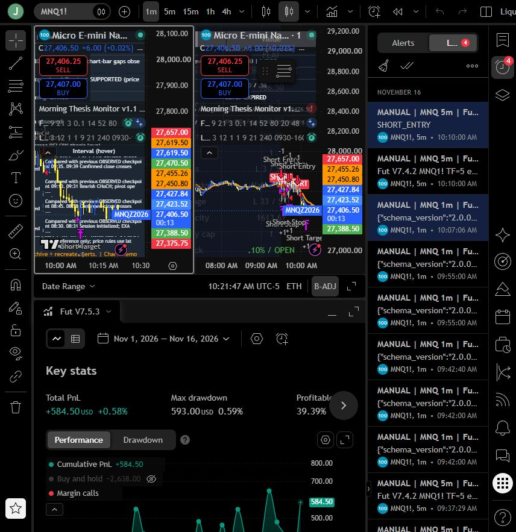

# Replacement alert reconciliation and regular-session entry/fill evidence

Observed November 16, 2026, approximately 10:10–10:14 America/New_York. This
follow-up reconciles the [09:39 missing-alert view](LIVE_DELIVERY_2026-11-16.md)
and supplements the [earlier delivery ledger](LIVE_DELIVERY_2026-11-15.md).

## Reconciliation without recreating duplicates

Initially, the pane again listed only two older inactive alerts. At the same
time, a live V7.4.2 SHORT_ENTRY browser toast appeared at 10:10, contradicting an
inference that all replacements were absent from the service. The layout showed
All changes saved before a normal browser reload. After reloading and reopening
the Alerts panel, all four original replacements were visible and Active. The
current log populated with regular-session events and the earlier November 15
replacement SESSION_EXIT entries.

This recovery is consistent with a stale browser view. The underlying root
cause is not established; no deletion or recreation is inferred. Saved alert
creation dates still showed November 15 (V7.5.3 13:53:51, LSM LONG 13:54:38,
LSM SHORT 13:55:36, V7.4.2 13:56:15). No replacement was recreated, cloned or
removed, avoiding duplicate manual notifications.




## Saved settings verified on all four

Each original saved definition was opened and its notification panel inspected.
All use mobile app, browser toast and sound; 3 Notes Reverb for 3 seconds; 24/7
notification schedule. Email, webhook URL and alternative plain-text email are
disabled. No saved definition was edited; inspection dialogs were canceled.

| Alert | Condition and interval | Trigger / message | Expiration, New York |
| --- | --- | --- | --- |
| Fut V7.5.3 | Released V7.5.3, MNQ1! 1m, research-1 | Order fills and alert() calls; `{{strategy.order.alert_message}}` | Dec 15, 13:53 |
| Fut V7.4.2 | Released V7.4.2, MNQ1! 5m | Order fills and alert() calls; readable legacy event/action/qty/price/position message | Dec 15, 13:55 |
| LSM LONG | LSM v1.1.1, MNQ1! 1m | Long: sweep + structure; Once per bar close; released stop/target placeholders | Dec 15, 13:54 |
| LSM SHORT | LSM v1.1.1, MNQ1! 1m | Short: sweep + structure; Once per bar close; released stop/target placeholders | Dec 15, 13:54 |

During inspection, an attempted row open inadvertently paused V7.5.3 at about
10:11:30. It was restarted immediately (Active confirmed by about 10:11:51).
This brief manual interruption is a coverage gap; no uninterrupted-monitoring
claim is made. Its definition was not changed or recreated. Final checks showed
all four Active. The two older inactive alerts were left unchanged.



## Regular-session logged events

Times below are TradingView log times on November 16 in America/New_York.
Only short-direction examples were observed; this does not cover every order
path. These are strategy emulator alerts, not broker execution confirmations.

| Script | Logged event evidence |
| --- | --- |
| V7.5.3 / 1m | SHORT_ENTRY pairs at 09:31, 09:42 and 09:55; SHORT_STOP_EXIT at 09:32:30 and 09:42:40; SHORT_TARGET_EXIT at 10:07:06 |
| V7.4.2 / 5m | SHORT_ENTRY text and expanded fill message at 09:35; expanded SHORT_STOP_EXIT fill message at 09:37:29; SHORT_ENTRY text and expanded fill message at 10:10 |
| LSM LONG/SHORT / 1m | No logged event; both remain Active with no latest-trigger time displayed |

The V7.4.2 fill messages contain resolved values, for example:

```text
Fut V7.4.2 MNQ1! TF=5 event=SHORT_ENTRY action=sell qty=1 price=27540.25 position=-1
Fut V7.4.2 MNQ1! TF=5 event=SHORT_STOP_EXIT action=buy qty=1 price=27617.75 position=0
Fut V7.4.2 MNQ1! TF=5 event=SHORT_ENTRY action=sell qty=1 price=27436.50 position=-1
```

This establishes expansion of the observed V7.4.2 order-fill placeholders and
server-side log delivery for those fills. A live SHORT_ENTRY toast at 10:10 was
captured directly; it contained the alert() text, not the expanded fill text.
Other entry/exit events were inspected retrospectively in the populated log;
no claim is made to have directly seen every toast.



The [structured visible-log extract](evidence/tradingview-reconciled-live-events.json)
preserves 16 visible alert rows, including the two earlier administrative rows,
and 10 parsed V7.5.3 payloads. All parsed payloads have schema 2.0.0, strategy
7.5.3, instance research-1 and preserved event-ID prefix, with no control
characters in event_id. Bracket exit payloads have null expiration and quantity
1. Entry examples have quantity 1 and submission-relative expiry 60 seconds
later. Bracket exits originate from source strategy.exit alert_message, so the
observed exit JSON provides native evidence that the configured order-fill
message placeholder emitted structured content. No broker reconciliation is
established. Paired identical entry records are consistent with fills plus
alert() calls; the UI extract does not separately label each member's origin.

## Receipt evidence and remaining scope

The user answered **yes** when asked whether mobile pushes and sound were
received for today's V7.5.3 entries/exits around 09:31–10:07 and V7.4.2 entries/
exit around 09:35–10:10. Record this as a broad user confirmation for the queried
strategy notifications. No individual event list, device, exact receipt time or
latency was supplied; it does not establish per-event receipt for every row.
Earlier SESSION_EXIT confirmations remain separate historical evidence.

| Delivery scope | Current result |
| --- | --- |
| Four original replacement alerts available | Reconciled: visible and Active after normal reload; no recreation needed |
| Strategy short entry/exit and fill log evidence | Observed for the examples above |
| V7.4.2 fill placeholders | Observed expanded for the logged examples |
| V7.5.3 structured fill message | Observed bracket-exit JSON with correct versions and identity |
| Browser toast | Directly captured V7.4.2 SHORT_ENTRY at 10:10; other current events are log evidence |
| Strategy mobile push and sound | Broad user confirmation; per-event/device/latency detail unverified |
| LSM LONG/SHORT end-to-end delivery | PENDING qualifying signals |
| Long-side strategy and exhaustive fill paths | UNVERIFIED |
| External receiver / broker fill reconciliation | UNVERIFIED; webhooks disabled |

Both chart views remained one minute and the second Morning Thesis monitor's
RE10066 error persisted. The V7.4.2 saved alert snapshot remained five minutes,
independent of the chart view. No source, signal filter or chart interval was
changed, and no broker order was placed. Chart context/monitor repair is not
claimed by this alert reconciliation.

## Follow-up at approximately 10:21 New York, November 16

The current Alerts list showed all four replacements Active. Latest-trigger
times remained 10:07:06 for V7.5.3 and 10:10:00 for V7.4.2; neither LSM alert
had a trigger time displayed. Both charts showed Market open. No alert was
opened, paused, restarted, edited or recreated during this follow-up.

The populated visible log was extracted through the browser accessibility text
and compared with the earlier [16-row capture](evidence/tradingview-reconciled-live-events.json).
All 16 rows matched exactly and in the same order, with zero new rows. No LSM
LONG/SHORT, newer strategy entry or newer fill event was observed. This is a
bounded visible-log comparison, not proof of absence after the check.

The [follow-up extract](evidence/tradingview-live-followup-1022.json) contains
those rows and an empty newRows list. Its filename identifies the capture
batch; the observed TradingView clock was 10:21:47 New York.
No new browser toast or payload was observed, and no additional mobile/sound
receipt evidence was collected. Earlier broad strategy receipt confirmation
remains scoped as recorded above. No extra delivery pass or failure is claimed.



LSM LONG/SHORT end-to-end delivery remains PENDING qualifying signals. The
previously recorded short-entry/fill evidence remains valid for its examples;
long-side and exhaustive paths, per-event device receipt/latency, and external
receiver/broker reconciliation remain UNVERIFIED. No chart interval or source
input was changed, and the separate Morning Thesis error was not addressed.
