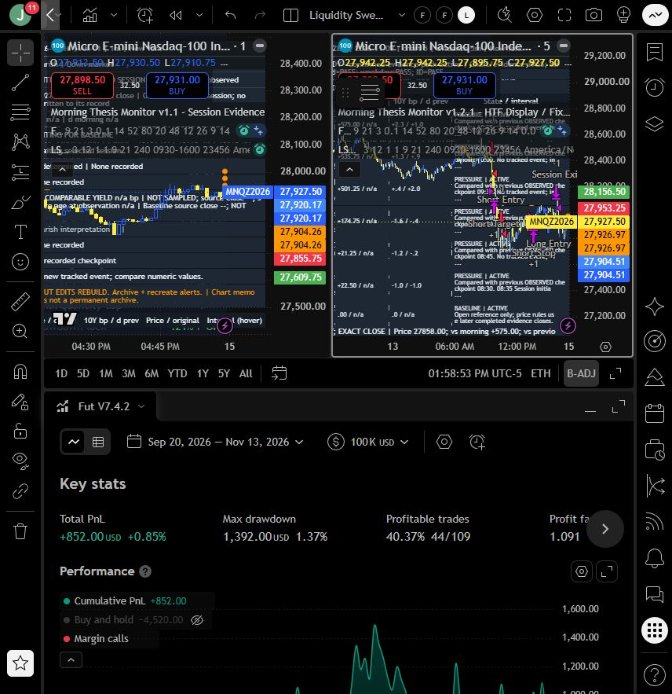
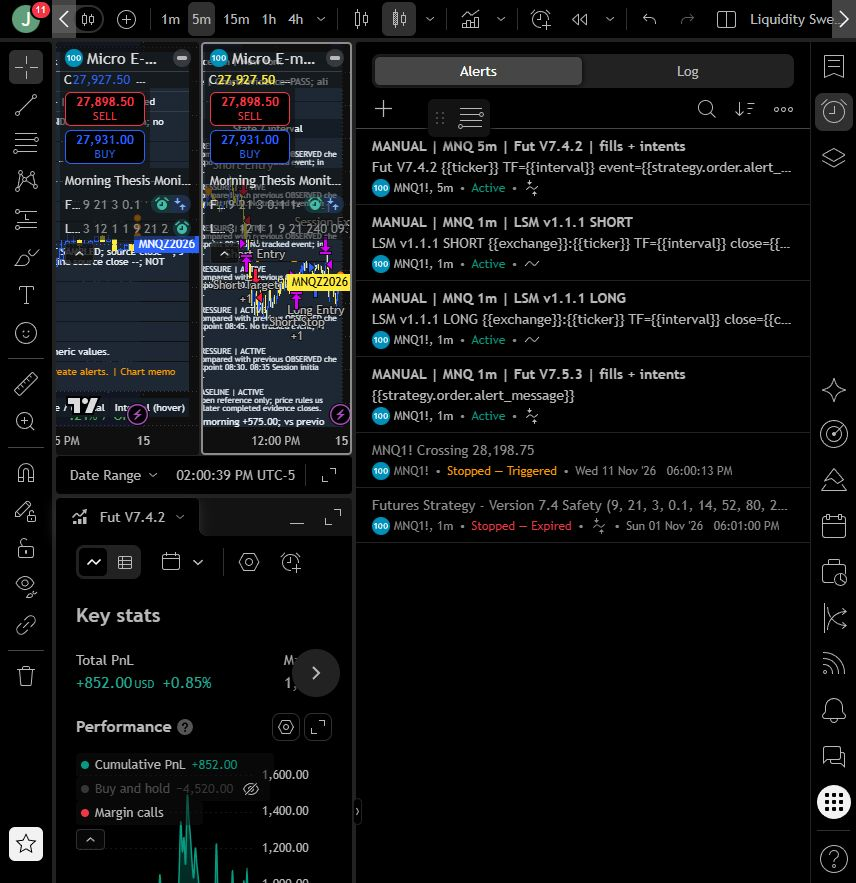

# Released chart deployment and saved-alert verification

Verified November 15, 2026, approximately 13:58–14:00 America/New_York, in the
signed-in joranie TradingView browser session. This follows publication of
[release v7.5.3: V7.5.3 / V7.4.2 / LSM v1.1.1](https://github.com/joranie-rgb/TradingView_py/releases/tag/v7.5.3),
tagged at `453e3e409dfc989ff0d09d943648c80b6fb22cd1`, including PR #18's JSON
escaping correction. This is a deployment/configuration observation, separate
from the [native compilation and payload checks](RELEASE_CHECKS_2026-11-15.md).

## Saved chart layout

Layout: [Liquidity Sweep + Break of Structure + Hide](https://www.tradingview.com/chart/p8iAPHsG/).
Both old FutuV7.4b strategy instances were removed through the chart object tree.
The final accessibility state contained no old strategy instance, both released
strategy labels, two LSM labels, and both Morning Thesis monitors. TradingView
reported **All changes saved**.

| Chart | Retained scripts |
| --- | --- |
| CME_MINI:MNQ1!, 1 minute | Fut V7.5.3; LSM v1.1.1; Morning Thesis Monitor v1.1 - Session Evidence |
| CME_MINI:MNQ1!, 5 minutes | Fut V7.4.2; LSM v1.1.1; Morning Thesis Monitor v1.2.1 - HTF Display / Fixed Evidence Engine |

Hollow candles, electronic trading hours and enabled back adjustment were
retained. Released strategy instances use the source defaults, including
USD 100,000 simulated initial capital, USD 2.50 per contract/fill commission and
one tick slippage. The removed older instances used USD 50,000; this record does
not claim their Properties were migrated. The released scripts were saved as
Released Fut V7.5.3, Released Fut V7.4.2 and Released LSM v1.1.1.



## Four saved replacement alerts

After cleanup, each replacement showed **Active**. Each saved definition was
opened for inspection; alert edits were canceled without changing its settings.
The condition fields explicitly named the released scripts, rather than V7.4b
or either Morning Thesis monitor.

| Saved alert name | Script / interval | Event mode or trigger | Expiration, New York time |
| --- | --- | --- | --- |
| MANUAL &#124; MNQ 1m &#124; Fut V7.5.3 &#124; fills + intents | Fut V7.5.3 / 1m; instance `research-1` | Order fills and alert() function calls | December 15, 2026, 13:53 |
| MANUAL &#124; MNQ 5m &#124; Fut V7.4.2 &#124; fills + intents | Fut V7.4.2 / 5m | Order fills and alert() function calls | December 15, 2026, 13:55 |
| MANUAL &#124; MNQ 1m &#124; LSM v1.1.1 LONG | LSM v1.1.1 / 1m | Long: sweep + structure; Once per bar close | December 15, 2026, 13:54 |
| MANUAL &#124; MNQ 1m &#124; LSM v1.1.1 SHORT | LSM v1.1.1 / 1m | Short: sweep + structure; Once per bar close | December 15, 2026, 13:54 |

LSM is installed on the five-minute chart for visual context, but no five-minute
LSM alert was created. The previous price alert remained Stopped — Triggered;
the previous strategy alert remained Stopped — Expired. Neither was reactivated.

### Saved messages

V7.5.3 order-fill message:

```text
{{strategy.order.alert_message}}
```

V7.4.2 order-fill message:

```text
Fut V7.4.2 {{ticker}} TF={{interval}} event={{strategy.order.alert_message}} action={{strategy.order.action}} qty={{strategy.order.contracts}} price={{strategy.order.price}} position={{strategy.position_size}}
```

LSM long message:

```text
LSM v1.1.1 LONG {{exchange}}:{{ticker}} TF={{interval}} close={{close}} stop={{plot("Latest reference stop")}} target={{plot("Latest reference target")}}
```

LSM short message:

```text
LSM v1.1.1 SHORT {{exchange}}:{{ticker}} TF={{interval}} close={{close}} stop={{plot("Latest reference stop")}} target={{plot("Latest reference target")}}
```

Strategy alert() calls supply their own source-defined messages. With both
fills and alert() calls enabled, an intent and a later emulator fill can produce
separate notifications for one setup. These are manual-review alerts, not a
receiver deployment.

### Notification settings inspected individually on all four

| Setting | Saved value |
| --- | --- |
| Notify in app | Enabled |
| Show toast notification | Enabled |
| Play sound | Enabled: 3 Notes Reverb, 3 seconds |
| Notification schedule | 24/7 |
| Send email | Disabled |
| Webhook URL | Disabled |
| Send plain text to alternative email | Disabled |

Opening a one-minute saved alert navigated the selected chart to one minute.
After all inspections, Chart #2 was restored to five minutes and the layout was
saved again. The final view retained the four Active statuses.



## Evidence scope and limits

The screenshots capture the cleaned layout and final active-alert list. Detailed
condition, trigger, expiration and notification values above were read from the
saved Edit alert dialogs; those individual dialogs are not pictured in these
two screenshots. This report records observed settings, not a source hash read
back from TradingView's saved alert snapshot. The sources were installed from
the tagged release during the preceding deployment.

The market was closed during inspection. **Live notification delivery remains
UNVERIFIED**, including mobile receipt, audible sound, placeholder expansion on
an actual event and post-cleanup forward execution. No broker orders were
submitted and no webhook was configured. External receiver deduplication,
expired-alert rejection and fill reconciliation remain **UNVERIFIED**.
Saved alerts retain source/input snapshots; future script, input or Properties
changes require alert recreation and another settings check. Active status is
an observation at the stated time, not a guarantee of future execution.
