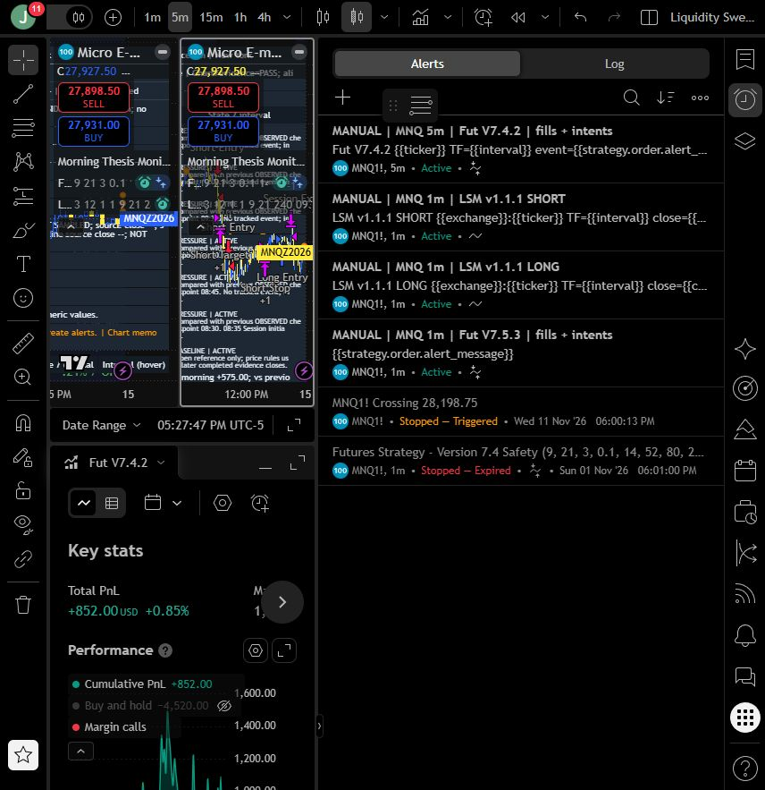
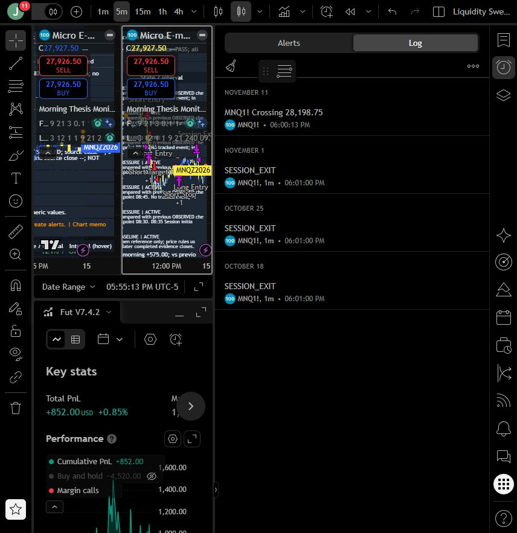
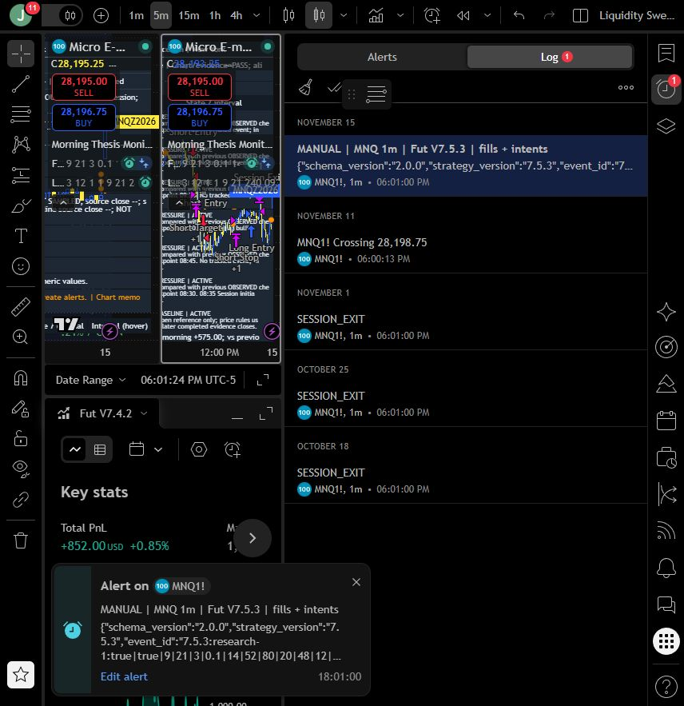
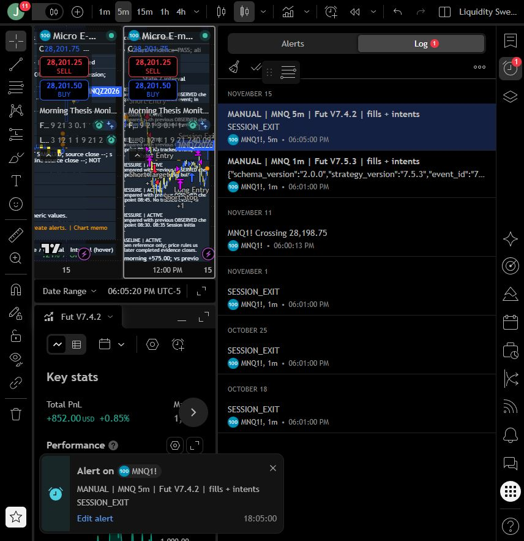
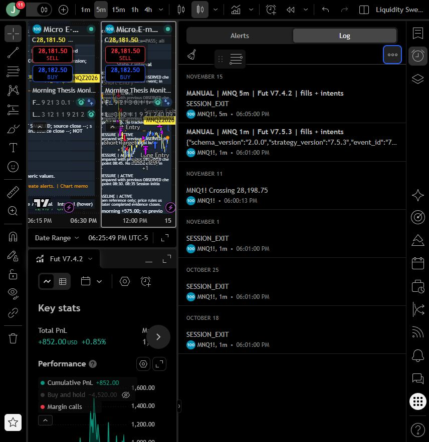
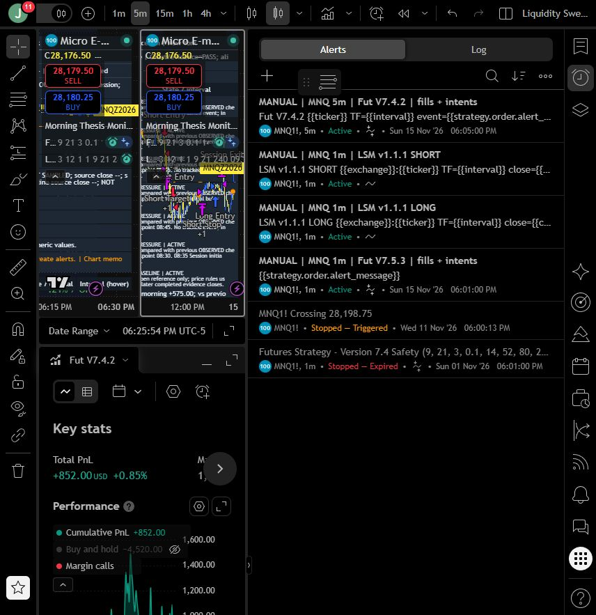
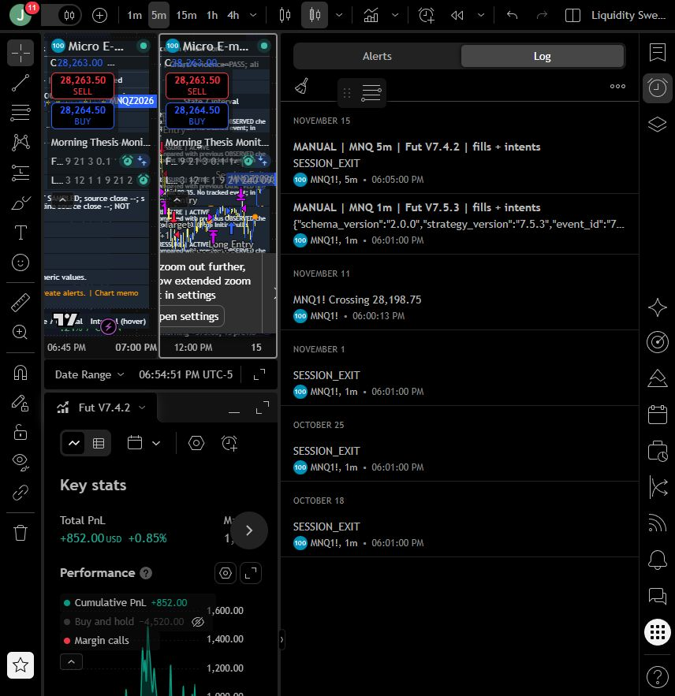

# Live manual-notification delivery — partial live evidence

## Baseline: November 15, 2026, 17:27 America/New_York

All four replacement alerts showed Active in the signed-in TradingView browser.
Both chart headers showed Market closed. The visible Log pane was empty; no
live replacement-alert event or notification delivery was observed in this check.
The log was not cleared or its filter configuration independently audited, so
this observation is limited to the visible pane. Existing scripts, alert inputs,
notification channels and conditions were not modified.

The user agreed to confirm mobile push receipt and audible notification sound.
No receipt confirmation has yet been supplied. Browser toast observation,
TradingView trigger history and user-confirmed device receipt are separate
checks; Active status alone passes none of the delivery checks.

## Timing and observation plan

[CME's Micro E-mini FAQ](https://www.cmegroup.com/articles/faqs/frequently-asked-questions-micro-e-mini-equity-index-futures.html)
lists the normal Sunday reopen at 18:00 Eastern. The next regular script entry
session is Monday, November 16, 2026, beginning 09:30 America/New_York, subject to
market availability. The saved strategy entry session is 09:30–15:45; LSM uses
09:30–16:00 with session days 23456 (Monday–Friday). Neither LSM direction is
guaranteed to signal on a particular day. The strategy session-cutoff fallback
may emit a SESSION_EXIT administrative event on resumed data after 15:50; such
an event can test its notification path but does not establish entry/fill delivery.

For each actual event, retain the alert name, event time including timezone,
script and interval, expanded message, and trigger-log screenshot. Inspect an
observed browser toast separately. Ask the user to confirm mobile push and sound
with receipt time and device/channel, without collecting account credentials.
Check placeholder expansion and version/event fields against the saved contract.
For V7.5.3 parse the emitted JSON and inspect schema 2.0.0, strategy 7.5.3 and
uncorrupted identity fields; for V7.4.2 inspect legacy event/fill fields; for LSM
inspect direction, symbol, interval, close and reference levels.

Do not relax signal filters, alter the saved alert snapshots, place broker
orders or substitute a test alert to manufacture a pass. A separate test of a
notification channel would not prove these four alerts delivered. An untriggered
alert is PENDING, not a failed notification. A logged trigger with no captured
toast is not automatically a failed toast: record the observation limits.

## Results ledger

| Alert | Trigger/log and emitted message | Browser toast | Mobile push | Sound | Overall |
| --- | --- | --- | --- | --- | --- |
| Fut V7.5.3 / MNQ 1m / fills + intents | SESSION_EXIT logged 18:01 Nov 15; JSON parsed | Observed and captured | User confirmed received | User confirmed received; device unspecified | PASS for observed SESSION_EXIT channels; entries/fills unverified |
| Fut V7.4.2 / MNQ 5m / fills + intents | SESSION_EXIT logged 18:05 Nov 15 | Observed and captured | User confirmed received | User confirmed received; device unspecified | PASS for observed SESSION_EXIT channels; entries/fills unverified |
| LSM v1.1.1 LONG / MNQ 1m / bar close | Not observed | Not observed | Awaiting user confirmation after event | Awaiting user confirmation after event | PENDING |
| LSM v1.1.1 SHORT / MNQ 1m / bar close | Not observed | Not observed | Awaiting user confirmation after event | Awaiting user confirmation after event | PENDING |

Full delivery across all four alerts is not established. No external receiver is configured; receiver
behavior remains UNVERIFIED. See the [saved-configuration record](DEPLOYMENT_ALERTS_2026-11-15.md)
for settings already inspected. Append timestamped observations and screenshots
when events occur, then submit the completed or explicitly partial results for
repository review. This document records bounded observations, not an unattended monitoring service.

## Follow-up check: November 15, 2026, 17:55 America/New_York

All four replacements remained Active. Both chart headers still showed Market
closed. The visible Log pane now displayed historical records: a price crossing
on November 11 at 18:00:13 and SESSION_EXIT records on November 1, October 25 and
October 18 at 18:01. None were from the newly created replacement alerts. The
earlier empty-pane observation is preserved as observed; this later view does
not support a claim that the account has no historical logs. No log was cleared.
No replacement event, expanded live payload or browser toast was observed, and
no mobile/sound receipt confirmation had been provided. All four results remain
PENDING; historical SESSION_EXIT entries do not count as current delivery evidence.

## Live V7.5.3 administrative event: November 15, 18:01 New York

TradingView showed Market open and logged the current replacement alert at
18:01:00. A browser notification toast was directly observed and captured with
the log entry. The [raw emitted payload](evidence/tradingview-753-live-session-exit.json)
was extracted from the visible log text and parsed as JSON. It contains schema
2.0.0, strategy 7.5.3, instance research-1, timeframe 1, SESSION_EXIT, action EXIT,
direction FLAT, quantity 0 and administrative_reason SESSION_CUTOFF. The event-ID
prefix is 7.5.3:research-1:; no control characters occur in event_id. The signal
timestamp 1794783660000 is 2026-11-15 18:01:00 America/New_York.

This is a live alert() administrative notification, not an emulator entry/fill
or broker order. It does not test the order-fill placeholder expansion path.
The expiration timestamp equals signal timestamp for this exit event; entry
expiration behavior and external receiver interpretation were not exercised.
Mobile push and sound receipt were requested from the user and remain pending
unless separately recorded below. No live-entry or fill-delivery pass is claimed.

User receipt confirmation for the 18:01 V7.5.3 event: **Mobile push and sound received**. This is user-reported delivery evidence; the device and exact receipt time were not specified. Browser toast/log are directly observed evidence.

## Live V7.4.2 administrative event: November 15, 18:05 New York

The replacement alert logged SESSION_EXIT at 18:05:00 on MNQ1!, 5m. Its browser
notification toast was directly observed and captured. The legacy text was
SESSION_EXIT, not JSON; this source-defined alert() message does not exercise
the configured order-fill message or fill placeholders. The user confirmed
**Mobile push and sound received** for this specific event. Device and exact
receipt time were not specified. This establishes the observed administrative
notification channels, not an entry/fill, broker execution or receiver integration.

## Observation-window outcome

Observation ran from approximately 17:55 through 18:05 on November 15. At 18:05
the visible log contained the two new replacement strategy events and the older
records already listed. No LSM long/short event or associated toast was observed.
Their signal session is closed at this time, so both LSM delivery checks remain
PENDING, not failed. User confirmation supports push and sound receipt for the
two strategy events only. No exact transport latency or device-specific sound
path can be inferred. No alert settings, source inputs or chart intervals were
changed, and no broker order or webhook request was submitted by this check.

## Follow-up: November 15, 2026, 18:25 America/New_York

Both chart headers showed Market open. The current visible log contained only
the two replacement SESSION_EXIT events already verified at 18:01 (V7.5.3)
and 18:05 (V7.4.2), followed by older historical records. No new LSM LONG, LSM
SHORT, strategy entry-intent or order-fill event was observed in this check.
The initially opened Log pane briefly appeared empty while loading; the log
populated before assessment. No records were cleared.

The Log Options menu was inspected: Current symbol, Current time interval,
Price, Technicals and Watchlist were all unchecked. No filter was changed. The
Alerts list then showed all four replacement alerts Active; latest-trigger
times remained 18:01 and 18:05 for the strategies, while both LSM alerts had no
trigger time displayed. This provides a bounded UI observation, not a guarantee
that no event could occur after the check. Screenshot filenames use 1826 as a
follow-up identifier; the UI checks and captures occurred around 18:25
New York time.

No new browser toast or expanded live message was observed, and no new mobile
push or sound receipt was reported for an LSM or entry/fill event. Earlier user
confirmations remain specific to the two SESSION_EXIT notifications. Thus the
results ledger is unchanged: LSM LONG/SHORT delivery stays PENDING; strategy
entry/fill delivery and order-fill placeholder expansion stay UNVERIFIED.

This Sunday evening check is outside the configured 09:30–15:45 strategy-entry
window and weekday 09:30–16:00 LSM signal window. Market open alone does not
make these signal conditions eligible. No filters, source inputs, alert
settings, chart intervals or broker connections were changed to force events.

## Follow-up requested as regular session: November 15, 18:54 New York

The requested check was performed immediately. The actual clock was Sunday,
November 15, 2026, approximately 18:54 America/New_York (23:54 UTC), so this
was an evening follow-up, not a regular-session validation. The next configured
weekday signal session begins Monday, November 16 at 09:30 New York time.

Both charts showed Market open and the saved layout showed All changes saved.
The Alerts list showed all four replacements Active. The strategies' latest
trigger times remained 18:01 for V7.5.3 and 18:05 for V7.4.2; neither LSM alert
displayed a trigger time. The populated Log showed those same two SESSION_EXIT
events followed by older historical records. No new LSM LONG/SHORT signal,
strategy entry-intent or order-fill event was observed.

No new live payload or browser toast was observed and no additional mobile push
or sound receipt was reported. The earlier receipt confirmations apply only
to the previously documented SESSION_EXIT events. No additional delivery pass
or failure is claimed. LSM LONG/SHORT delivery remains PENDING; strategy
entry/fill delivery and order-fill placeholder expansion remain UNVERIFIED.
This check does not establish that eligible regular-session signals have been
observed. No alerts, signal filters, source inputs or chart intervals were
changed, and the log was not cleared.

## Subsequent regular-session observation

The [November 16 follow-up](LIVE_DELIVERY_2026-11-16.md) was inside the configured
signal windows, but the current account view listed only two older inactive
alerts and zero Active alerts. The four replacements and their November 15 log
entries were not visible. Earlier evidence is retained; current availability
must be reconciled before further end-to-end delivery validation.
