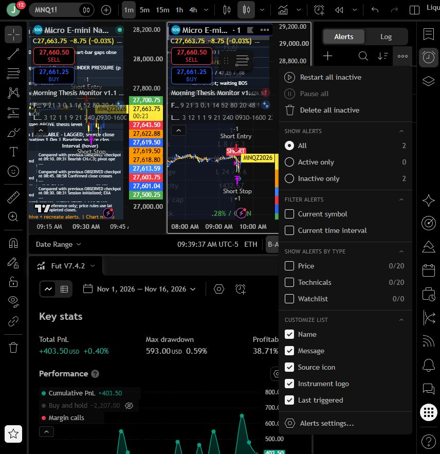
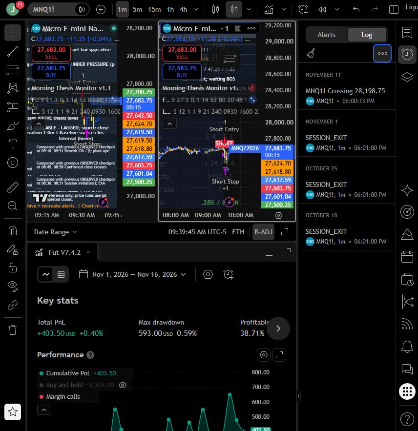

# Regular-session alert check — November 16, 2026

Observed approximately 09:39 America/New_York (14:39 UTC), Monday November 16,
inside the configured strategy entry and weekday LSM signal windows. Both MNQ
charts showed Market open. This is the first recorded regular-session follow-up
to the [November 15 delivery ledger](LIVE_DELIVERY_2026-11-15.md).

## Current alert availability differs from earlier evidence

The signed-in TradingView account label was joranie on the same layout URL.
Alerts Options explicitly showed **All 2**, **Active only 0**, **Inactive only 2**,
with All selected. The two listed alerts were the older price crossing (Stopped
— Triggered, November 11) and the older V7.4 strategy alert (Stopped — Expired,
November 1). None of the four MANUAL replacement alerts was listed.

Current symbol, Current time interval, Price, Technicals and Watchlist filters
were unchecked. No filter was changed, and no alert was restarted or recreated.
These observations establish that the four replacements are not visible in the
current account view; they do not establish who changed them, whether they were
deleted, or the underlying persistence/session cause.

## Current log and delivery evidence

The visible Log contained a November 11 price-crossing entry and SESSION_EXIT
entries on November 1, October 25 and October 18. It contained no November 15
replacement SESSION_EXIT entries and no November 16 LSM LONG/SHORT, strategy
entry-intent or order-fill entries. Log Options showed Current symbol, Current
time interval, Price, Technicals and Watchlist unchecked. The log was not cleared.

No new payload or browser toast was observed, and no new mobile push or sound
receipt confirmation was supplied. Prior user confirmations apply only to the
two November 15 administrative notifications. Earlier screenshots and the emitted
JSON remain preserved; the current view's missing historical entries do not
invalidate those time-bounded observations or establish a delivery failure.

| Scope | Current result |
| --- | --- |
| Regular-session observation performed | Yes, approximately 09:39 New York |
| Four replacement alerts currently Active | Not established; current UI reports zero Active and lists no replacements |
| LSM LONG/SHORT live delivery | PENDING; no new event observed; alert availability must be reconciled |
| Strategy entry/fill delivery | UNVERIFIED; no new event observed |
| Order-fill placeholder expansion | UNVERIFIED |
| November 15 SESSION_EXIT log/toast and user-reported push/sound | Earlier evidence retained, scoped to those events |

This is a configuration-availability blocker to continued delivery validation,
not evidence that eligible signals failed notification transport. A successful
end-to-end regular-session delivery pass cannot be claimed from this view.

## Chart context and next verification

The released Fut V7.5.3, Fut V7.4.2 and two LSM v1.1.1 instances remained in the
chart legends, along with both Morning Thesis monitors. Both charts were now
one minute, whereas the November 15 saved deployment had V7.4.2 on five minutes.
The second Morning Thesis Monitor displayed Runtime error RE10066. Its error
was not diagnosed in this read-only alert inspection. The layout already had an
unsaved-change indicator when inspection began; it was not saved or restored.
These differences are recorded without attributing them to a particular cause.
A chart strategy report or marker is not evidence of alert delivery.

Before another live-delivery attempt, reconcile the account's replacement-alert
availability and intended chart configuration. If replacements need recreation,
first verify no duplicate deployment is running elsewhere, then restore the
reviewed versions, intervals, messages, triggers and manual-only channels using
the [deployment record](DEPLOYMENT_ALERTS_2026-11-15.md). Record any new creation
time and observe actual qualifying signals; do not infer a pass from Active
status. No source, alert settings, chart interval, broker connection or order was
changed during this check.
