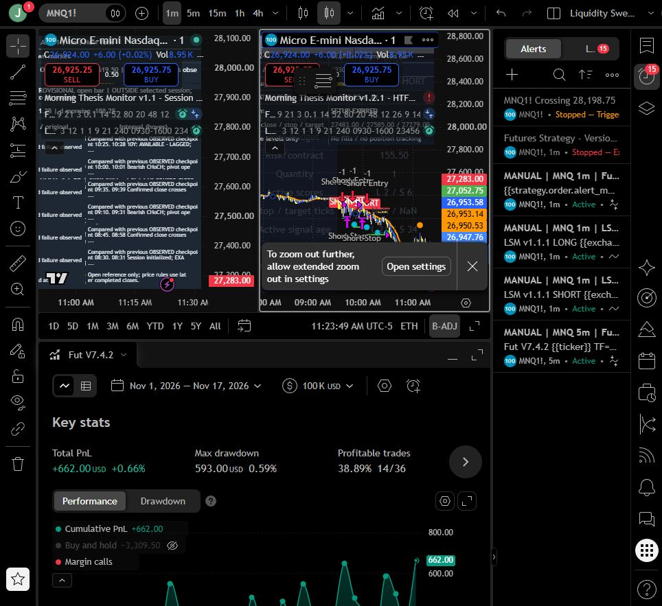
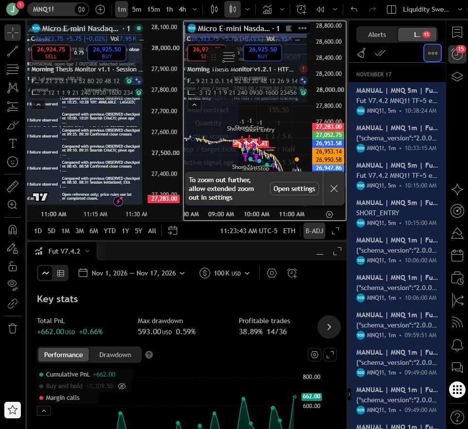

# Live strategy follow-up and pending LSM LONG — November 17, 2026

Inspected approximately 11:23 America/New_York during the regular session.
This adds dated evidence to the [November 16 long-entry report](LONG_ENTRY_DELIVERY_2026-11-16.md)
and [LSM SHORT report](LSM_SHORT_DELIVERY_2026-11-16.md).

## Current alert inventory

All four replacements remained Active. LSM LONG had no latest-trigger time and
no LONG signal appeared in the populated log. LSM SHORT retained its November 16
11:13 trigger. V7.5.3's latest trigger was November 17 at 10:33:15; V7.4.2's was
November 17 at 10:38:24. Both chart views remained one minute; the saved V7.4.2
alert remained five minutes. The separate Morning Thesis RE10066 error persisted.
No chart, alert or source settings were changed, and no log was cleared.



## New dated log evidence

The log initially appeared empty while loading, then populated. Its Options
menu showed Current symbol, Current time interval, Price, Technicals and
Watchlist unchecked. No filters were changed. The [visible-log extract](evidence/tradingview-live-events-2026-11-17.json)
preserves 21 rows with explicit date labels: 15 from November 17 and six from
November 16. This is a bounded visible snapshot, not complete-history or
continuous-observation evidence.

| Date | Script | Logged event examples newly recorded here |
| --- | --- | --- |
| Nov 17 | V7.5.3 / 1m | SHORT_ENTRY pairs at 09:36, 09:49 and 10:06; SHORT_STOP_EXIT at 09:41:28 and 09:59:51; SHORT_TARGET_EXIT at 10:33:15 |
| Nov 17 | V7.4.2 / 5m | SHORT_ENTRY intent and expanded fill at 09:35 and 10:15; SHORT_STOP_EXIT fill at 09:41:23; SHORT_TARGET_EXIT fill at 10:38:24 |
| Nov 16 | V7.4.2 / 5m | LONG_STOP_EXIT fill at 11:54:22, following the previously recorded 11:35 long entry |

V7.4.2 expanded messages include:

```text
Nov 17 09:35:00  Fut V7.4.2 MNQ1! TF=5 event=SHORT_ENTRY action=sell qty=1 price=27244.50 position=-1
Nov 17 09:41:23  Fut V7.4.2 MNQ1! TF=5 event=SHORT_STOP_EXIT action=buy qty=1 price=27307.75 position=0
Nov 17 10:15:00  Fut V7.4.2 MNQ1! TF=5 event=SHORT_ENTRY action=sell qty=1 price=27200.00 position=-1
Nov 17 10:38:24  Fut V7.4.2 MNQ1! TF=5 event=SHORT_TARGET_EXIT action=buy qty=1 price=26992.50 position=0
Nov 16 11:54:22  Fut V7.4.2 MNQ1! TF=5 event=LONG_STOP_EXIT action=sell qty=1 price=27492.50 position=0
```

The dates/times above annotate the literal message text. The resolved fields
provide native log evidence for these emulator fill-message examples, not broker
fills or external reconciliation. In particular, the November 16 long stop is
an exit example absent from the earlier entry-only report. It does not resolve
the separate unclassified November 16 10:52:31 trigger.

Ten V7.5.3 payloads parsed successfully, including nine November 17 entry/exit
rows and one November 16 SESSION_EXIT. All retain schema 2.0.0, strategy 7.5.3,
instance research-1 and an intact event-ID prefix without control characters.
Paired entry records are preserved, not counted as independent setups. All six
entry payload records expire 60 seconds after the submission timestamp encoded
in event_id. The 10:06 example retains a 10:04 signal_timestamp and expires at
10:07, so expiry is not incorrectly described as 60 seconds after setup time.
Stop/target exit payloads have null expiration. This is payload/log verification,
not receiver-expiry enforcement or full accounting reconciliation.



## Notification evidence and remaining limits

A browser notification card for the November 17 V7.4.2 SHORT_TARGET_EXIT was
directly visible during the 11:23 inspection, showing the expanded fill message
and event time 10:38:24. It was captured retrospectively; original arrival time
and latency are unknown. No toast was directly observed for every other row.


The user subsequently answered **yes** to the question asking about mobile push
and sound for November 17 V7.5.3 short entries/exits around 09:36–10:33,
V7.4.2 short entries/exits around 09:35–10:38, and the November 16 V7.4.2
LONG_STOP_EXIT at 11:54. This is a broad confirmation in response to the grouped
question, not an individually itemized receipt for every event or log row. The
user did not distinguish groups, devices or exact receipt times. Per-event
receipt attribution, device-specific behavior and latency remain unverified.

| Scope | Status after this check |
| --- | --- |
| LSM LONG end-to-end delivery | PENDING qualifying signal |
| Previously observed LSM SHORT | Prior log and user push/sound evidence retained; no newer trigger |
| New strategy entry/stop/target messages | Observed in dated log for the examples above |
| V7.4.2 long-stop fill | Newly documented Nov 16 example, not a new Nov 17 long trade |
| V7.4.2 target-fill browser card | Directly observed retrospectively; latency unverified |
| Mobile push/sound for queried event groups | Broad user confirmation; individual rows/groups not itemized |
| V7.5.3 long-side, exhaustive order paths, device latency and external receiver/broker reconciliation | UNVERIFIED |

No blanket delivery pass is claimed for every log record, strategy direction
or channel. No broker orders were submitted by this inspection.

## 13:27 follow-up: V7.4.2 short entry and stop exit

The next bounded inspection occurred November 17 at approximately 13:27
America/New_York (the TradingView clock showed 13:26:53–13:26:56 UTC-5).
Compared with the 11:23 observation above, the populated log contained three
new V7.4.2 / MNQ 5m rows:

| Logged time | Message |
| --- | --- |
| 11:35:00 | `SHORT_ENTRY` |
| 11:35:00 | `Fut V7.4.2 MNQ1! TF=5 event=SHORT_ENTRY action=sell qty=1 price=26907.00 position=-1` |
| 12:17:53 | `Fut V7.4.2 MNQ1! TF=5 event=SHORT_STOP_EXIT action=buy qty=1 price=27055.25 position=0` |

The first two rows are the intent and expanded emulator-fill message for one
entry, not two independent setups. The stop-exit row resolves event, action,
quantity, price and flat position. These are retrospective native log
observations, not direct observations of notification arrival or broker fills.
The [structured follow-up record](evidence/tradingview-742-short-followup-2026-11-17.json)
transcribes these observed values; no screenshot was saved for this inspection.
The earlier screenshots and 11:23 JSON remain unchanged and do not depict these
later events.

All four original replacement alerts showed Active. Latest-trigger values were
V7.4.2 November 17 12:17:53, V7.5.3 November 17 10:33:15 (unchanged),
and LSM SHORT November 16 11:13 (unchanged). LSM LONG had no latest-trigger
time and no LONG event appeared in the populated log. Its delivery remains
**PENDING**, not failed. No newer V7.5.3 or LSM SHORT event was observed.

Mobile push, sound and browser-toast delivery for the new 11:35 entry and
12:17 stop remain **UNVERIFIED**. The earlier grouped user confirmation covers
the previously queried events only and must not be extended to these later
rows. Individual receipt attribution, devices, exact receipt times and latency
remain unverified. V7.5.3 long-side examples, exhaustive order paths, the
unclassified November 16 V7.4.2 10:52:31 trigger, and external receiver
deduplication/expiry enforcement/broker reconciliation remain unverified.
No external receiver is configured. This was not continuous monitoring or
complete-history verification.

Both chart views remained one minute while the saved V7.4.2 alert showed five
minutes. The separate Morning Thesis Monitor RE10066 error persisted. No alert
settings, source inputs or chart intervals were changed, no log was cleared,
and no broker orders were submitted. No new filter inspection was performed.

## 19:43 follow-up: both strategies' 15:50 SESSION_EXIT

Inspected November 17 at approximately 19:43 America/New_York; the TradingView
clock showed 19:43:08–19:43:14 UTC-5. Compared with the 13:27 inspection, the
populated log showed two newer administrative notifications, both dated
November 17 at 15:50:00:

| Saved alert | Observed message |
| --- | --- |
| V7.5.3 / MNQ 1m | Structured `SESSION_EXIT`, schema `2.0.0`, strategy `7.5.3`, instance `research-1`, action `EXIT`, direction `FLAT`, quantity `0`, reason `SESSION_CUTOFF` |
| V7.4.2 / MNQ 5m | Literal legacy `SESSION_EXIT` |

The V7.5.3 message showed signal_timestamp and expiration_timestamp both
1794948600000, risk_day_id 1794891600000, and null stop/target bracket ticks.
These are administrative alert messages, not new order-fill or broker-fill
evidence. No additional entry, stop or target message newer than the previously
documented 12:17:53 V7.4.2 stop appeared in the inspected log.

A V7.5.3 SESSION_EXIT browser notification card with event time 15:50:00 was
directly visible during the 19:43 inspection. This is retrospective card
visibility, not a direct observation of original arrival or latency. No
V7.4.2 SESSION_EXIT toast was directly observed. The
[structured observation record](evidence/tradingview-session-exit-followup-2026-11-17.json)
preserves a transcription of the observed fields and channel limits; no
screenshot was saved for this inspection. Earlier images do not depict these
new events. No new log-filter inspection was performed.

All four original replacement alerts remained Active. Both strategies' latest
trigger fields advanced to November 17 15:50:00. LSM SHORT remained at November
16 11:13:00. LSM LONG had no latest-trigger time and no LONG event appeared in
the populated log: delivery remains **PENDING**, not failed.

Mobile push and sound for both new 15:50 events remain **UNVERIFIED**, as does
V7.4.2 browser-toast receipt. Earlier user confirmations do not cover these
events. Push/sound/toast receipt for the 11:35 V7.4.2 entry and 12:17 stop also
remains unverified. Per-event attribution, devices, exact arrival times and
latency remain unverified. V7.5.3 long-side examples, exhaustive order paths,
the unclassified November 16 V7.4.2 10:52:31 trigger, and external receiver
deduplication/expiry enforcement/broker reconciliation remain unverified; no
external receiver is configured.

The first chart showed one minute and the second five minutes, unlike the two
one-minute views at 13:27. This inspection did not change chart intervals,
alert settings or source inputs, clear the log, or submit broker orders. It
was a bounded retrospective inspection, not continuous monitoring or complete
history verification. The evening inspection was outside the configured entry
and weekday LSM signal windows; Market open does not establish signal eligibility.
