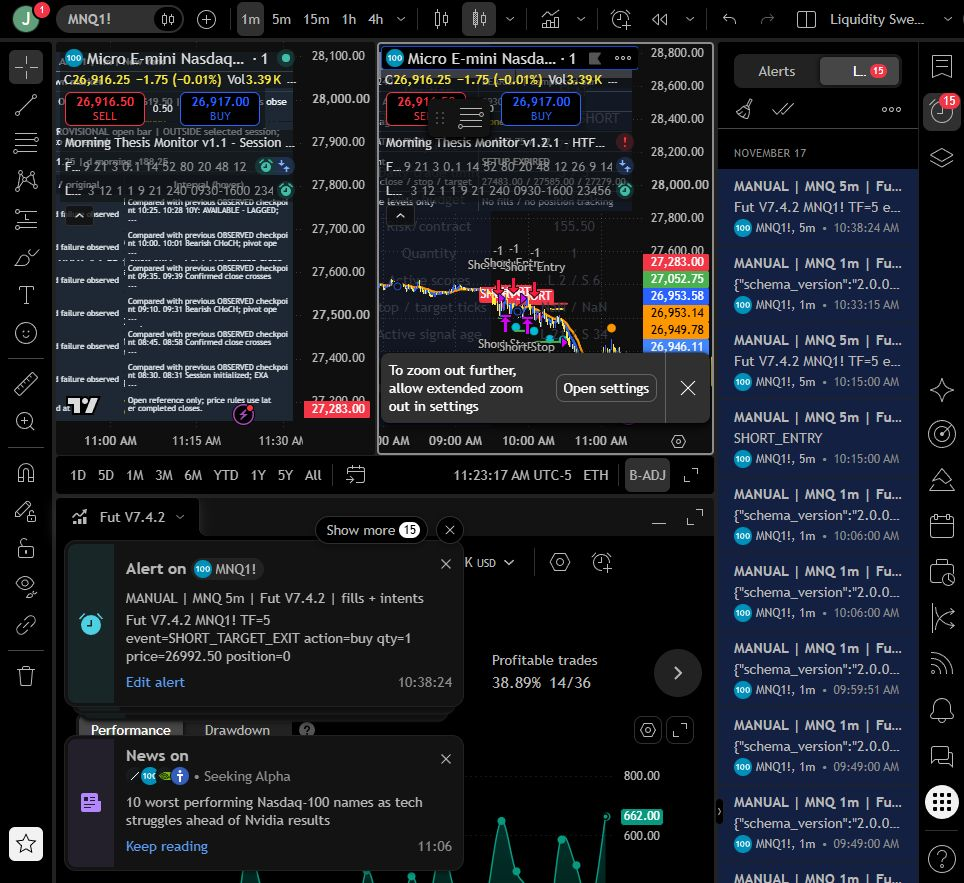

# Live strategy follow-up and pending LSM LONG — November 17, 2026

Inspected approximately 11:23 America/New_York during the regular session.
This adds dated evidence to the [November 16 long-entry report](LONG_ENTRY_DELIVERY_2026-11-16.md)
and [LSM SHORT report](LSM_SHORT_DELIVERY_2026-11-16.md).

## Current alert inventory

All four replacements remained Active. LSM LONG had no latest-trigger time and
no LONG signal appeared in the populated log. LSM SHORT retained its November 16
11:13 trigger. V7.5.3's latest trigger was November 17 at 10:33:15; V7.4.2's was
November 17 at 10:38:24. Both chart views remained one minute; the saved V7.4.2
alert remained five minutes. The separate Morning Thesis RE10066 error persisted.
No chart, alert or source settings were changed, and no log was cleared.


## New dated log evidence

The log initially appeared empty while loading, then populated. Its Options
menu showed Current symbol, Current time interval, Price, Technicals and
Watchlist unchecked. No filters were changed. The [visible-log extract](evidence/tradingview-live-events-2026-11-17.json)
preserves 21 rows with explicit date labels: 15 from November 17 and six from
November 16. This is a bounded visible snapshot, not complete-history or
continuous-observation evidence.

| Date | Script | Logged event examples newly recorded here |
| --- | --- | --- |
| Nov 17 | V7.5.3 / 1m | SHORT_ENTRY pairs at 09:36, 09:49 and 10:06; SHORT_STOP_EXIT at 09:41:28 and 09:59:51; SHORT_TARGET_EXIT at 10:33:15 |
| Nov 17 | V7.4.2 / 5m | SHORT_ENTRY intent and expanded fill at 09:35 and 10:15; SHORT_STOP_EXIT fill at 09:41:23; SHORT_TARGET_EXIT fill at 10:38:24 |
| Nov 16 | V7.4.2 / 5m | LONG_STOP_EXIT fill at 11:54:22, following the previously recorded 11:35 long entry |

V7.4.2 expanded messages include:

```text
Nov 17 09:35:00  Fut V7.4.2 MNQ1! TF=5 event=SHORT_ENTRY action=sell qty=1 price=27244.50 position=-1
Nov 17 09:41:23  Fut V7.4.2 MNQ1! TF=5 event=SHORT_STOP_EXIT action=buy qty=1 price=27307.75 position=0
Nov 17 10:15:00  Fut V7.4.2 MNQ1! TF=5 event=SHORT_ENTRY action=sell qty=1 price=27200.00 position=-1
Nov 17 10:38:24  Fut V7.4.2 MNQ1! TF=5 event=SHORT_TARGET_EXIT action=buy qty=1 price=26992.50 position=0
Nov 16 11:54:22  Fut V7.4.2 MNQ1! TF=5 event=LONG_STOP_EXIT action=sell qty=1 price=27492.50 position=0
```

The dates/times above annotate the literal message text. The resolved fields
provide native log evidence for these emulator fill-message examples, not broker
fills or external reconciliation. In particular, the November 16 long stop is
an exit example absent from the earlier entry-only report. It does not resolve
the separate unclassified November 16 10:52:31 trigger.

Ten V7.5.3 payloads parsed successfully, including nine November 17 entry/exit
rows and one November 16 SESSION_EXIT. All retain schema 2.0.0, strategy 7.5.3,
instance research-1 and an intact event-ID prefix without control characters.
Paired entry records are preserved, not counted as independent setups. All six
entry payload records expire 60 seconds after the submission timestamp encoded
in event_id. The 10:06 example retains a 10:04 signal_timestamp and expires at
10:07, so expiry is not incorrectly described as 60 seconds after setup time.
Stop/target exit payloads have null expiration. This is payload/log verification,
not receiver-expiry enforcement or full accounting reconciliation.


## Notification evidence and remaining limits

A browser notification card for the November 17 V7.4.2 SHORT_TARGET_EXIT was
directly visible during the 11:23 inspection, showing the expanded fill message
and event time 10:38:24. It was captured retrospectively; original arrival time
and latency are unknown. No toast was directly observed for every other row.



Mobile push and sound confirmation was requested for today's strategy events and
the newly recorded November 16 long stop. No new receipt confirmation is recorded
here yet; earlier confirmations must not be extended automatically to these
new events. Device, per-event receipt time and latency remain unverified.

| Scope | Status after this check |
| --- | --- |
| LSM LONG end-to-end delivery | PENDING qualifying signal |
| Previously observed LSM SHORT | Prior log and user push/sound evidence retained; no newer trigger |
| New strategy entry/stop/target messages | Observed in dated log for the examples above |
| V7.4.2 long-stop fill | Newly documented Nov 16 example, not a new Nov 17 long trade |
| V7.4.2 target-fill browser card | Directly observed retrospectively; latency unverified |
| New mobile push/sound receipts | UNVERIFIED pending user confirmation |
| V7.5.3 long-side, exhaustive order paths, device latency and external receiver/broker reconciliation | UNVERIFIED |

No blanket delivery pass is claimed for every log record, strategy direction
or channel. No broker orders were submitted by this inspection.
