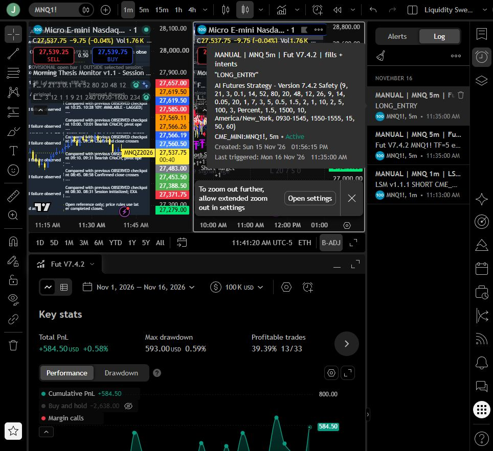
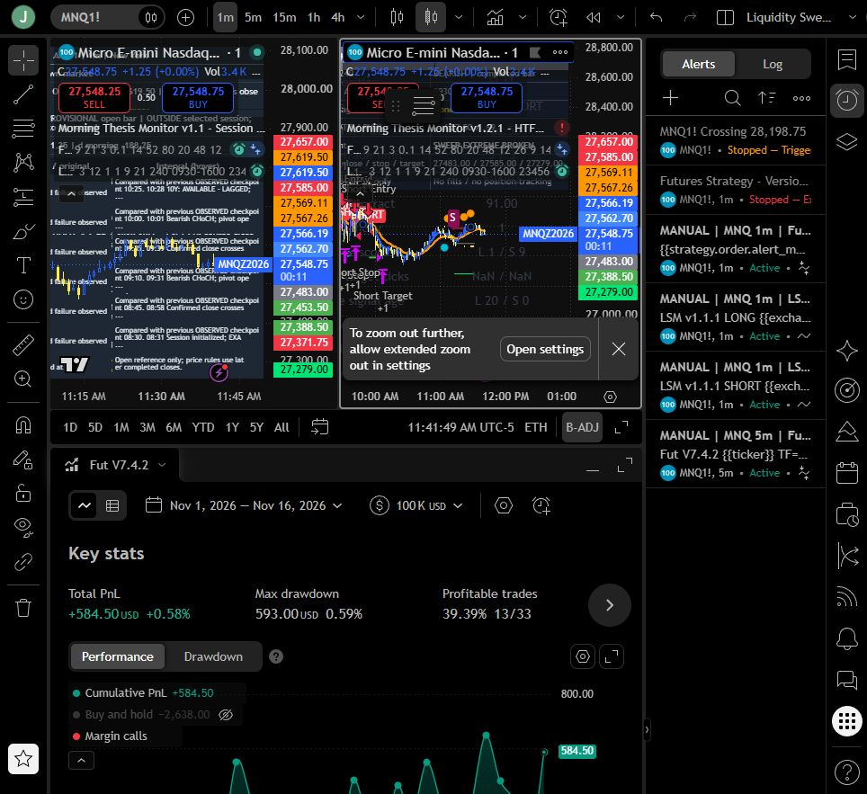

# V7.4.2 LONG_ENTRY live evidence — November 16, 2026

Inspected approximately 11:41 America/New_York, inside the regular session.
This follows the [LSM SHORT delivery report](LSM_SHORT_DELIVERY_2026-11-16.md).

## New strategy event and delivery

The populated TradingView log contained two V7.4.2 rows at **11:35:00 AM** on
MNQ1!, 5m: the source-defined alert() intent LONG_ENTRY and an expanded
order-fill message:

```text
LONG_ENTRY
Fut V7.4.2 MNQ1! TF=5 event=LONG_ENTRY action=buy qty=1 price=27601.50 position=1
```

The second row demonstrates resolved legacy event/action/quantity/price/position
placeholders for this long entry. It is an emulator fill notification, not a
broker fill confirmation. The separate browser notification card showing the
alert name and LONG_ENTRY was directly visible and captured during the 11:41
inspection; its event time was 11:35. This retrospective observation does not
establish when the card first appeared or notification latency. No browser
card for the expanded fill text was directly observed.



The user specifically confirmed **Mobile push and sound received** for the
queried V7.4.2 LONG_ENTRY at 11:35. This confirms receipt for the queried event,
not separately for both log rows. Device, exact receipt time and latency were
not specified. The [structured record](evidence/tradingview-742-long-entry-1135.json)
preserves the message text, event/observation times and channel limits.

## Other alerts and bounded history

All four replacements remained Active. Latest-trigger fields were V7.5.3 at
10:07:06, V7.4.2 at 11:35:00 and LSM SHORT at 11:13:00. LSM LONG had no trigger
time displayed and no LONG signal appeared in the current log.



The populated current log displayed the two 11:35 rows and the previously
recorded 11:13 LSM SHORT row. Earlier history was not present in this view, so
this observation does not classify the previously unclassified V7.4.2 10:52:31
trigger or establish complete history coverage. No log was cleared or alert
settings, source inputs, chart intervals or broker connections changed. The
separate Morning Thesis monitor error was left unchanged.

## Updated verification scope

| Scope | Result |
| --- | --- |
| V7.4.2 long-entry intent and emulator-fill messages | Observed in the log, 11:35 |
| V7.4.2 long-entry fill placeholder expansion | Observed for the recorded example |
| Browser notification | LONG_ENTRY card directly observed during 11:41 check; expanded-fill card unobserved |
| Mobile push and sound | Event-specific user confirmation; not per-row receipt or latency evidence |
| LSM LONG delivery | PENDING qualifying signal |
| V7.5.3 long-side examples, long exits and exhaustive order paths | UNVERIFIED by this check |
| Previously unclassified 10:52:31 trigger | Still unclassified |
| Per-event device/latency and external receiver/broker reconciliation | UNVERIFIED |

Earlier short-strategy and LSM SHORT evidence remains preserved with its own
scope. This adds one V7.4.2 long-entry example, not a blanket pass for every
strategy direction, lifecycle event or channel.

## Later inspected long-stop evidence

The [November 17 follow-up](LIVE_DELIVERY_2026-11-17.md) newly records the
November 16 V7.4.2 LONG_STOP_EXIT at 11:54:22. This extends log coverage for that
example only. A later broad push/sound confirmation in response to a grouped
question including the long stop is recorded there; it is not an individually
itemized receipt and is separate from the earlier entry-only confirmation.
