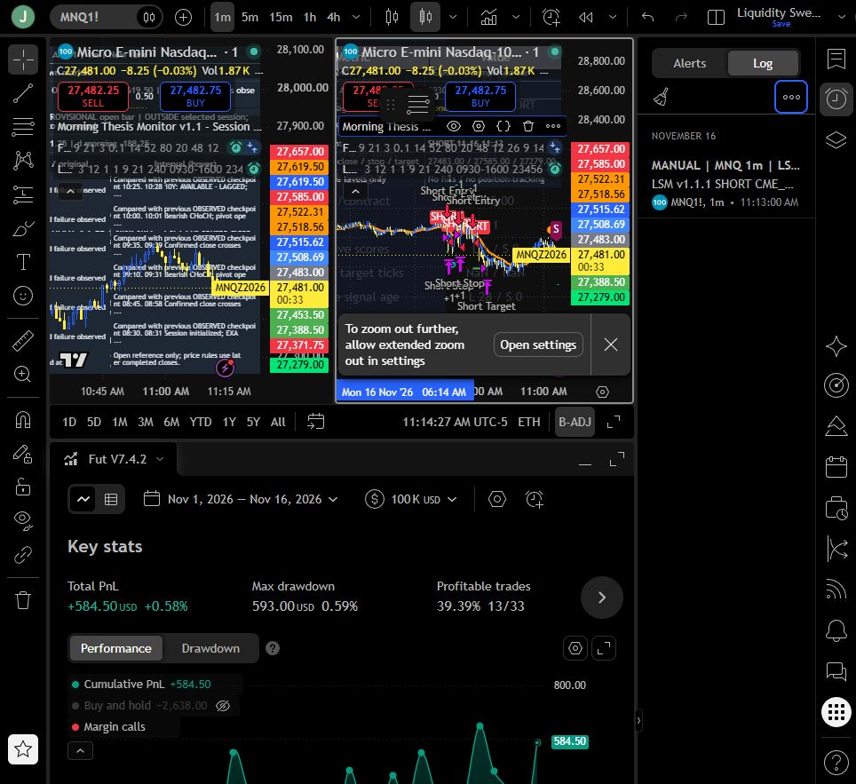
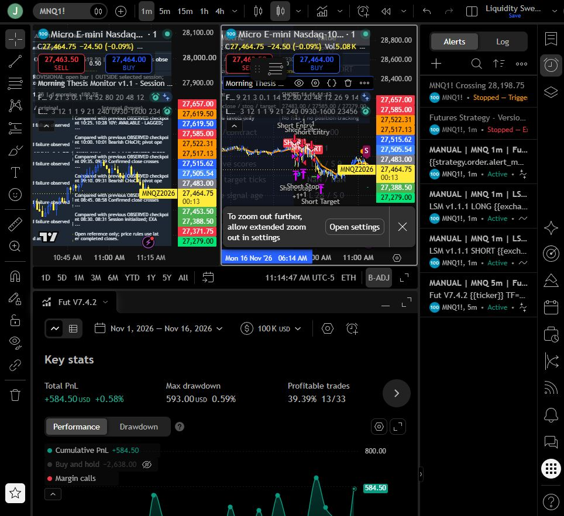

# LSM SHORT live delivery — November 16, 2026

Observed approximately 11:14 America/New_York during the configured regular
signal session. This supplements the [reconciliation report](ALERT_RECONCILIATION_2026-11-16.md),
including its prior short-strategy entry/fill evidence and 10:21 follow-up.

## New LSM SHORT event

TradingView's populated log showed MANUAL | MNQ 1m | LSM v1.1.1 SHORT at
**11:13:00 AM** on November 16. The resolved message was:

```text
LSM v1.1.1 SHORT CME_MINI:MNQ1! TF=1 close=27483.00 stop=27585 target=27279
```

The message has the released version/direction, symbol, timeframe and numeric
close/stop/target values; no placeholder braces remain. Reference stop 27585 is
above close 27483, target 27279 below, with 102 points of stop distance and 204
points of target distance, consistent with the configured 2R reference plan.
These are indicator reference levels, not fill or position claims. A chart
reference plot alone was not used as notification evidence.



The user specifically confirmed **Mobile push and sound received** for the
11:13 LSM SHORT alert. This is event-specific user receipt evidence. Device and
exact receipt time were unspecified, so transport latency and sound source
remain unverified. The browser toast was not directly observed in this check;
its enabled setting and log entry do not establish that channel's delivery.
The [structured evidence record](evidence/tradingview-lsm-short-event-1113.json)
separates these channel results and records the visible message verbatim.

## Current alert inventory and strategy follow-up

All four replacement alerts remained Active. The latest-trigger times were:

| Alert | Latest-trigger field | Current evidence |
| --- | --- | --- |
| Fut V7.5.3 / 1m | 10:07:06 | No newer trigger time than the prior capture |
| Fut V7.4.2 / 5m | 10:52:31 | Newer trigger timestamp; event type and payload not available in current log view |
| LSM SHORT / 1m | 11:13:00 | New logged SHORT with resolved message and user-confirmed push/sound |
| LSM LONG / 1m | No trigger time displayed | Still pending qualifying signal/delivery evidence |



The current populated Log contained only the LSM SHORT row, whereas the previous
capture contained 16 rows. Current symbol, Current time interval, Price,
Technicals and Watchlist filters were unchecked. No filter was changed and the
log was not cleared by this inspection. The reason earlier rows were absent is
not established; no deletion or cleared-history cause is inferred. Therefore,
the 10:52:31 V7.4.2 latest-trigger field is evidence of a newer trigger time,
not proof of a particular new entry/fill, its payload or notification receipt.
Earlier strategy examples remain preserved in the reconciliation report.

No new strategy message was captured here. Existing user receipt confirmations
are not extended to the unclassified 10:52:31 trigger. No alerts were edited,
paused, restarted, recreated or removed. Source inputs, chart intervals and the
pre-existing unsaved layout were left unchanged. The second Morning Thesis
monitor's RE10066 error remained present and was not diagnosed in this check.

## Updated delivery scope

| Scope | Status |
| --- | --- |
| LSM SHORT trigger and placeholder expansion | Observed for this 11:13 example |
| LSM SHORT mobile push and sound | Event-specific user confirmation |
| LSM SHORT browser toast | UNVERIFIED: not directly observed |
| LSM LONG end-to-end delivery | PENDING qualifying signal |
| New V7.4.2 trigger at 10:52:31 | Timestamp observed; event type/payload/channel receipt UNVERIFIED |
| Prior short-strategy entry/fill examples | Retained with original scope and receipt limitations |
| Long-side/exhaustive strategy paths, per-event latency, external receiver/broker reconciliation | UNVERIFIED |

This bounded check adds LSM SHORT evidence only; it is not a blanket pass for
both LSM directions or every notification channel.

## Subsequent strategy evidence

The [11:35 V7.4.2 long-entry report](LONG_ENTRY_DELIVERY_2026-11-16.md) records
a newer classified long intent/fill example. LSM LONG remains pending; the
earlier unclassified 10:52:31 trigger is not resolved by this later event.
