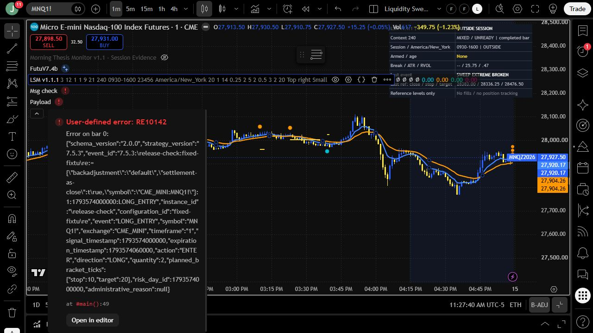
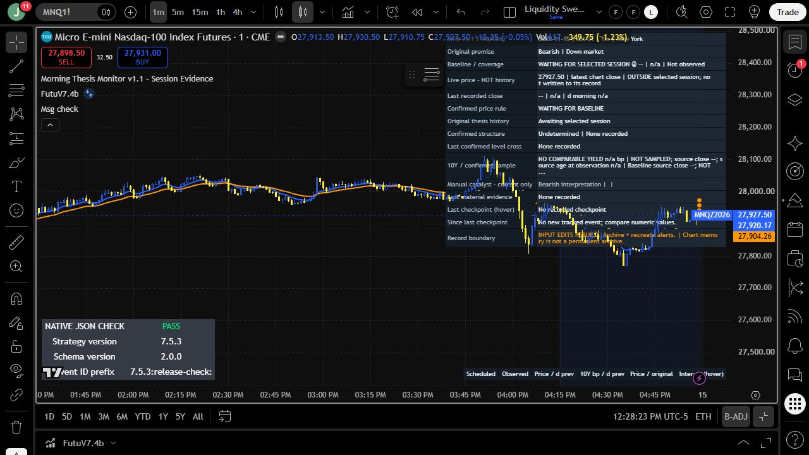
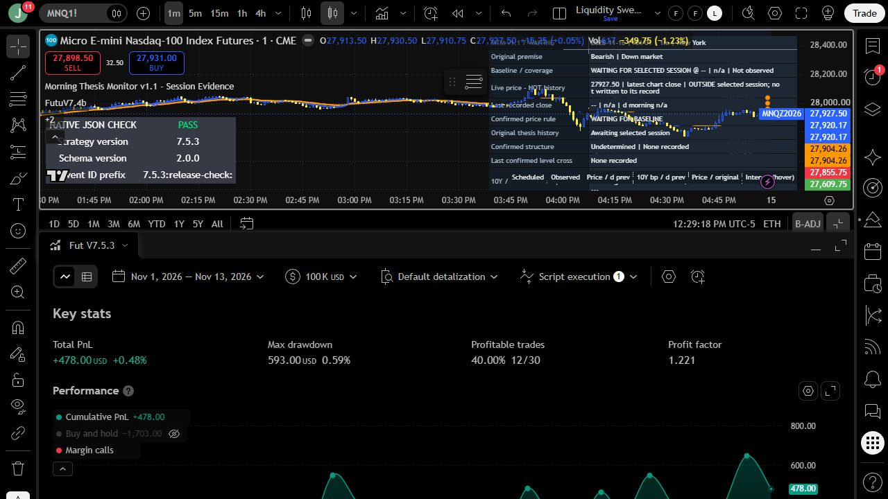
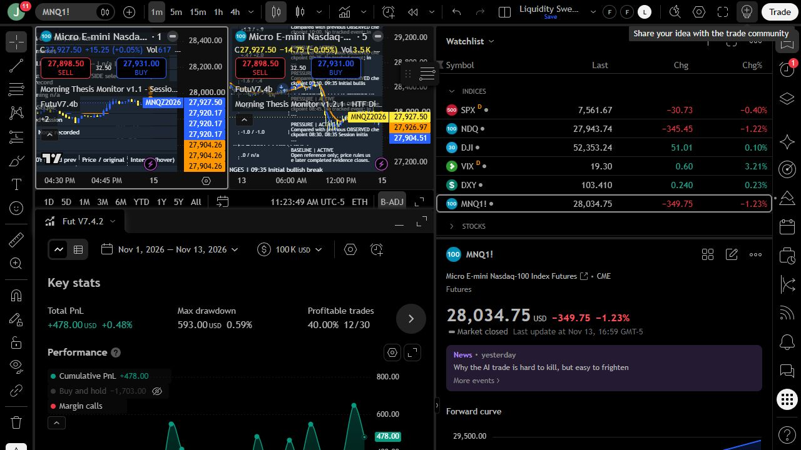
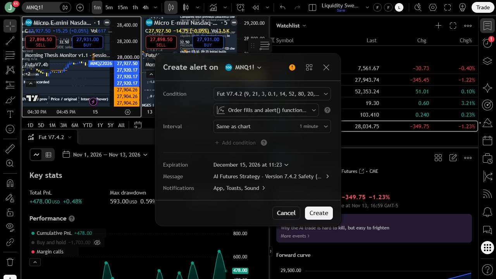
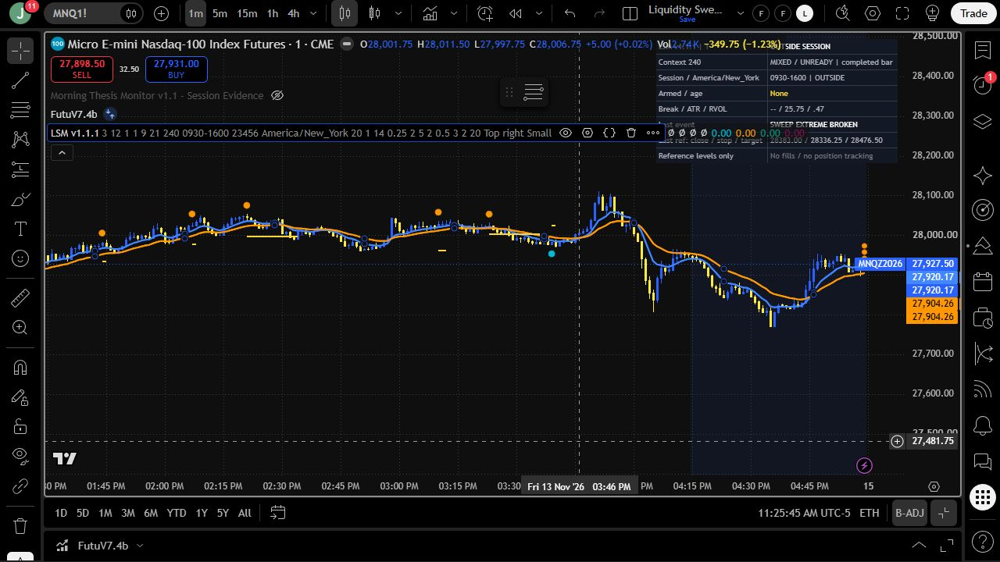
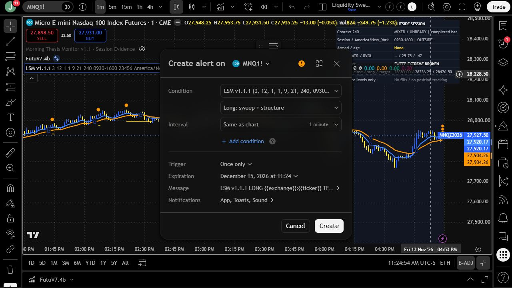
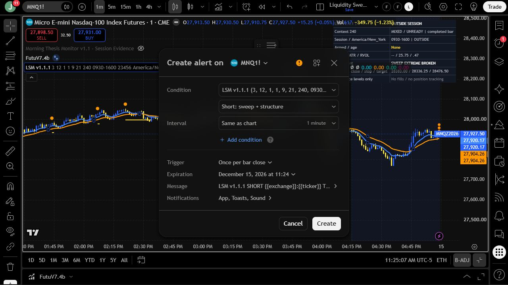
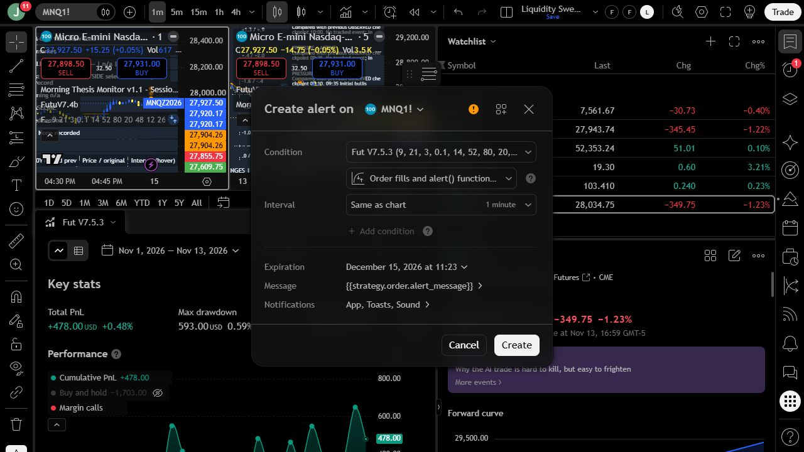

# Final release compilation and message checks

Checked November 15, 2026, beginning with merged main
`b15c20ad34422a53a60b9b544ed65ed1156c4df9`. V7.5.3, compatibility V7.4.2 and
LSM v1.1.1 were each pasted unmodified into TradingView Pine Editor and accepted
onto a standard one-minute CME_MINI:MNQ1! chart. Both strategies completed the
November 1-13 historical evaluation: 30 closed trades, USD 478.00 net,
USD 593.00 maximum drawdown, 12/30 profitable and profit factor 1.221, with
source default USD 100,000, USD 2.50 commission per contract/fill and one tick
slippage. These are smoke results, not a trading-performance claim.

## Labels and alert setup

- The full strategy titles and chart/alert labels showed **Fut V7.5.3** and
  **Fut V7.4.2**. The indicator rendered its panel and plots with **LSM v1.1.1**.
- The LSM alert dialog offered Long: sweep + structure and Short: sweep +
  structure. Their messages started `LSM v1.1.1 LONG` and `LSM v1.1.1 SHORT`
  and retained exchange, ticker, interval, close and named stop/target plot
  placeholders. Once per bar close was selectable in the unsaved draft.
- Strategy setup offered order fills and alert() function calls. TradingView's
  default order-fill message is generic text, not the source's alert payload.
  An unsaved V7.5.3 draft accepted `{{strategy.order.alert_message}}`, as required
  by USER_GUIDE.md. Every draft was canceled without creating an alert.
- V7.4.2 keeps legacy messages such as LONG_ENTRY, SHORT_ENTRY and SESSION_EXIT.
  The source was inspected for these constants; they have no new JSON version
  field. Historical execution does not verify live transmission of them.

## Native JSON failure discovered

Full-script compilation alone did not establish payload correctness. A separate
indicator probe copied the exact production message helpers into a no-order,
no-alert script and serialized a synthetic LONG_ENTRY with instance
`release-check` and configuration `fixed-fixture`. A native assertion failed.
The diagnostic payload is preserved in
[the failure record](RELEASE_PAYLOAD_FAILURE_2026-11-15.json).

The old jsonString helper attempted to escape carriage returns using a Pine
string literal containing backslash-r. Pine supports newline and tab escapes,
but an unsupported escape retains the following letter. The replacement
therefore matched every lowercase r, converting it to JSON backslash-r.
Parsing the native payload turned the first character of release-check into
U+000D (character code 13); instance/configuration values no longer round-tripped.
The default research-1 label is affected too. Strategy/schema version fields
were correct, but message identity verification failed on merged main.

The earlier Python evaluator incorrectly interpreted that literal with Python's
carriage-return semantics, so its original 58 passing tests missed this native
Pine defect. The evaluator now models the supported literal escapes and only
the production U+000D regex subset; it remains a bounded evaluator, not Pine.

## Correction and verification

The correction matches the actual U+000D character through `str.match` with a
Unicode regex and replaces it only when present. Ordinary r characters remain
unchanged. No trade selection, order, sizing, schema or version values changed.
The unpublished 7.5.3 candidate retains its version while this correction is
reviewed; merged main does not contain the correction until this PR is merged.

Corrected V7.5.3 source SHA256 (UTF-8, LF-normalized):

`e21e82f3fc3a8e96aead9c6158d25a20b986d324615fb01d13ac60d1875cf3a6`

The [standalone native probe](release_message_check.pine) passed after copying
the corrected helpers. It checks strategy_version 7.5.3, schema_version 2.0.0 and
the complete expected instance/configuration prefix in event_id. This exercises
ordinary r preservation in the actual Pine runtime. Actual carriage-return,
newline, tab, quote and backslash round trips have local expression coverage;
the control-character input cases were not separately injected into hosted Pine.

The entire corrected strategy then compiled and completed with the same
30-trade report above. V7.4.2 and LSM sources did not require correction.
No actual alert was delivered, and external receiver testing remains UNVERIFIED.

## Local checks and cleanup

Local regressions cover regular r values, control-character JSON round trips,
instance/configuration/event identity, supported versus unsupported literal
escapes, the narrow regex contract, and native-probe helper synchronization.
The generated accounting fixture was refreshed for the corrected source digest;
its controlled-order logic is unchanged. Historical reports and hashes remain
unchanged. All temporary instances were removed and the original chart split,
style, monitor visibility, watchlist and strategy report were restored.

Pine semantics reference: [TradingView strings and escape sequences](https://www.tradingview.com/pine-script-docs/concepts/strings/#escape-sequences).
