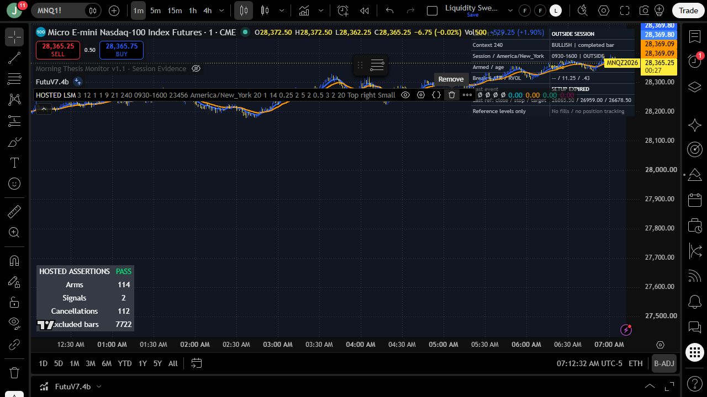
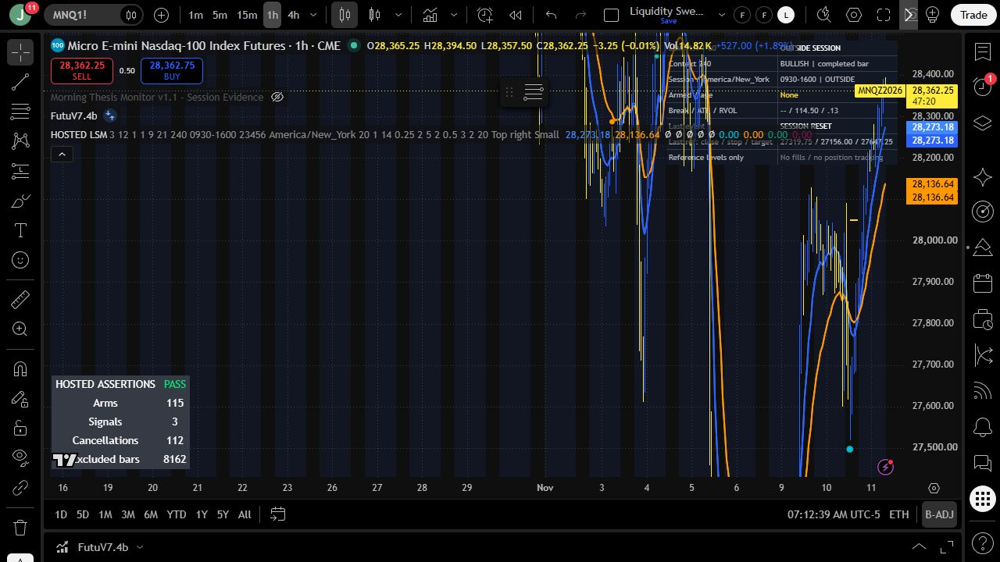
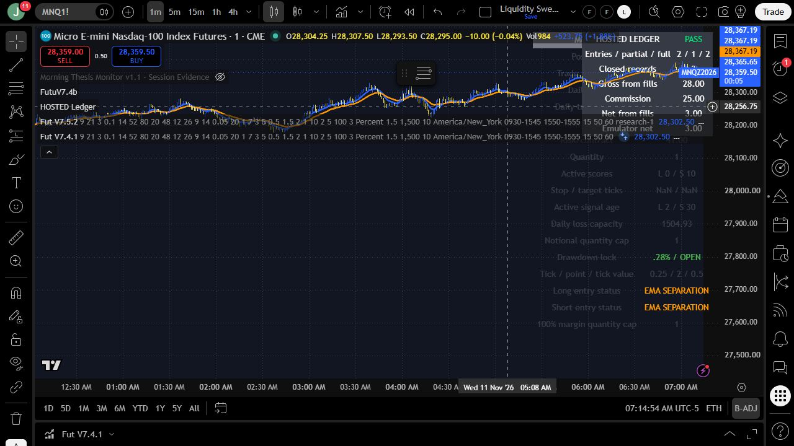
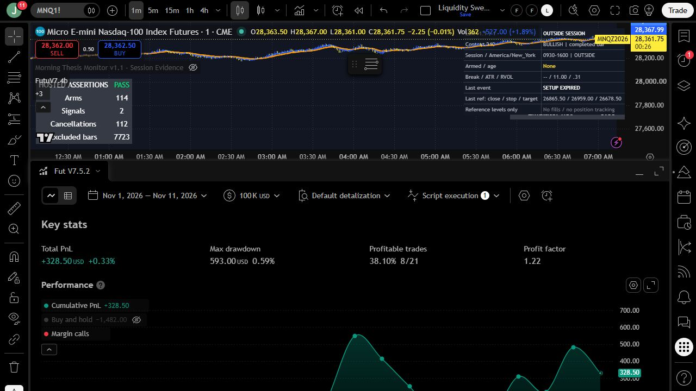
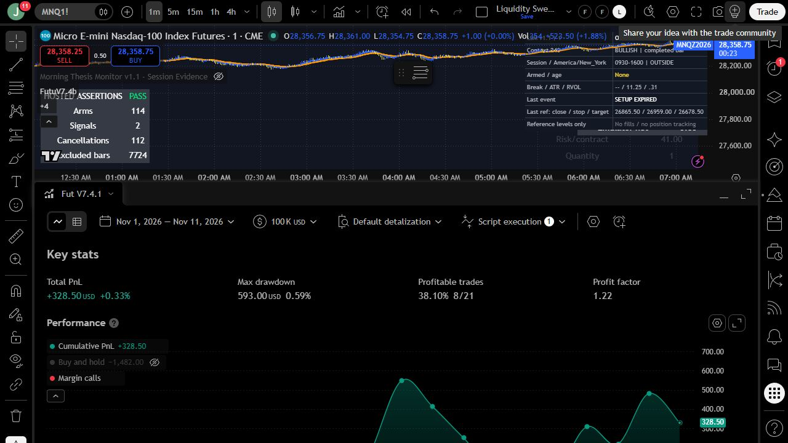

# Hosted lifecycle and accounting results - November 11, 2026

## Revision and environment

Sources were tested on branch `codex/hosted-lifecycle-accounting`, based on
merged main `2e20310934e3e63e3c7050b795d89ab514accb8a`. Digests below identify
production source exactly (UTF-8, LF-normalized). Display versions 7.5.2, 7.4.1
and LSM 1.1 remain unreleased; this patch does not publish a versioned release.

| Source | SHA256 |
| --- | --- |
| `futures_v7_5.pine` | `9d94057a7a8705a11ec87eaef37722c1361e5528d23a91c59ed549bd4cdb5a96` |
| `futures_v7_4.pine` | `726833561c49cc5596e6e5b4036b27d10a70ff3a92eaa9b7b8cabb6a2ebdfae9` |
| `liquidity_structure_v1.pine` | `fb7d6c9aa881f59cdea0c830f6d7f6f4afae74c225df3c3489f63f346201179b` |

TradingView hosted Pine v6, authenticated user joranie, CME_MINI:MNQ1!, standard
candles, Electronic Trading Hours, back adjustment on. Indicator default session
09:30-16:00, days 23456, America/New_York, HTF 240. One-minute chart evaluation
covered the loaded November 1-11 history; hourly history contained 10,988 bars.
Counters cover loaded history, not just the visible chart window. No Bar Replay
playback or live alert delivery was performed. Temporary chart instances were
removed and the original SPX five-minute hollow-candle view and user scripts
were restored. No alerts or broker orders were created.

## Defect found and corrected

Before this patch, `time(timeframe.period, session)` and its matching synthetic
session close were treated as the actual chart candle boundaries. For hourly
MNQ candles aligned on the hour and a 09:30 session, the generated session grid
starts at half past the hour. All 10,988 tested hourly bars were excluded,
producing zero arms, signals and cancellations: INCOMPLETE COVERAGE.

All three production scripts now test actual bar-open membership at minute
resolution and calculate the session end as a timestamp in the configured
calendar/timezone. Overnight ends advance to the next calendar date, including
year boundaries and DST. The actual close must be no later than that endpoint.
The separate mixed-calendar-date exclusion remains in effect. A 10:00-11:00
bar fits 09:30-16:00; a 15:00-16:00 bar does not fit 09:30-15:45.

## Indicator lifecycle

The generated fixture copies the entire production indicator, changes only its
test title and adds observation/assertion code. First-bar synthetic Pine checks
cover touch versus breach, cancellation priority, expiry, date classification,
23/25-hour New York DST days, hourly alignment and overnight year rollover.
Historical state-machine assertions check that cancellation precedes signals,
new arms do not signal on the same bar, excluded bars cannot arm/confirm,
frozen levels do not move, each arm has a separate drawing ID and reference
targets retain at least one favorable tick.

| Timeframe | Arms | Signals | Cancellations | Excluded bars at capture | Result |
| --- | ---: | ---: | ---: | ---: | --- |
| 1 minute | 114 | 2 | 112 | 7,722 | PASS |
| 1 hour | 115 | 3 | 112 | 8,162 | PASS |

The excluded-bar counter can advance as a new outside-session bar closes.
These results establish the assertions for observed historical paths; they do
not guarantee exhaustive state-space coverage or realtime equivalence.

## Forced-order accounting reconciliation

The fixture uses exact production observation/reset/counting logic, but replaces
signal selection with controlled orders. It enters three long MNQ contracts,
closes one, closes the remainder, enters two and closes them. The anchor is
November 10, 2026, 23:57 New York. Properties: USD 500,000 capital (to afford
three contracts at 100% margin), USD 2.50 per contract per fill, one tick modeled
slippage, same-close market processing, no pyramiding, no calculation on fills
and no calculation on every tick.

TradingView's List of Trades labels below are **bar opening times**. Orders
process at those bars' closing ticks; the fixture observes the changed position
on the following calculation. Do not infer the exact millisecond fill timestamp
from the displayed minute label.

| Record | Entry bar | Exit bar | Contracts | Entry fill | Exit fill | Gross USD | Commission USD | Net USD |
| --- | --- | --- | ---: | ---: | ---: | ---: | ---: | ---: |
| Partial | Nov 10 23:57 | Nov 10 23:58 | 1 | 28,191.50 | 28,196.00 | 9.00 | 5.00 | 4.00 |
| Remainder | Nov 10 23:57 | Nov 10 23:59 | 2 | 28,191.50 | 28,194.75 | 13.00 | 10.00 | 3.00 |
| Second entry | Nov 11 00:00 | Nov 11 00:01 | 2 | 28,192.00 | 28,193.50 | 6.00 | 10.00 | -4.00 |
| Total | | | 5 | | | **28.00** | **25.00** | **3.00** |

Gross uses `(exit fill - entry fill) * contracts * MNQ point value 2`.
The independent sum agrees with `strategy.netprofit` within one cent; hosted
table PASS. Two entries, one partial, two full exits and three closed records
were observed. Assertions also passed for retaining the plan sentinel through
a partial exit, starting cooldown only on a full exit, not recounting the old
entry after midnight, counting the fresh entry once and resetting daily
baselines to the previous available equity/net-profit valuation.

The daily baseline remains the documented conservative previous-valuation
policy. This is not an exact independently sampled midnight broker balance.
The plan sentinel is an accounting-fixture device, not a full test of production
brackets, every forced liquidation, FX conversion or short-side fills.

## Full production-source smoke tests

The corrected, uninstrumented strategy files both compiled and completed on
MNQ one-minute standard candles, November 1-11, 2026, with source defaults:
USD 100,000, USD 2.50 commission per contract/fill and one tick slippage. Both
reported 21 closed trades, net +328.50 USD, maximum drawdown 593.00 USD, 8/21
profitable and profit factor 1.22. These are smoke-test observations; differing
dates and history prevent comparison with the earlier November 6 result.
No performance improvement or statistical success claim is made.

## Repository audit and limits

- Local suite: 55 passing tests, including source-extracted session-end checks
  for hourly alignment, early/late overnight bars, year rollover, DST and
  full-day sessions; generated fixtures reproduce the current production source.
- Production diff is limited to session-window membership/end calculation.
  No credentials, external endpoints, dependencies, execution permissions or
  alert schema changes were introduced. Existing malformed-ID rejection,
  sizing limits and calendar-date exclusions remain covered by regression tests.
- Existing alerts retain a source snapshot. Recreate alerts when adopting this
  unreleased patch. Version publication remains a separate release operation.
- **External receiver testing: UNVERIFIED.** No receiver/broker implementation
  was supplied or exists in this repository. Durable deduplication, expired-alert
  rejection, authentication, retries and broker fill reconciliation were not
  tested. This is explicitly outside the completion gate per the user's
  November 11 instruction.
- Live delivery, replay playback, all liquidation/FX paths and trading
  profitability remain unverified. Historical assertions and local checks do
  not establish those properties.

Execution-model reference: [TradingView strategies documentation](https://www.tradingview.com/pine-script-docs/concepts/strategies/).
