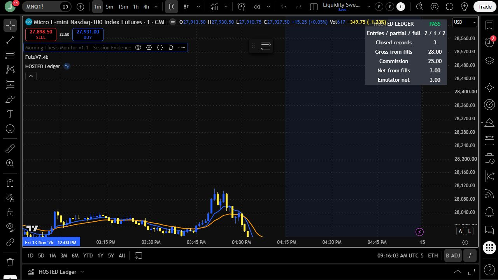
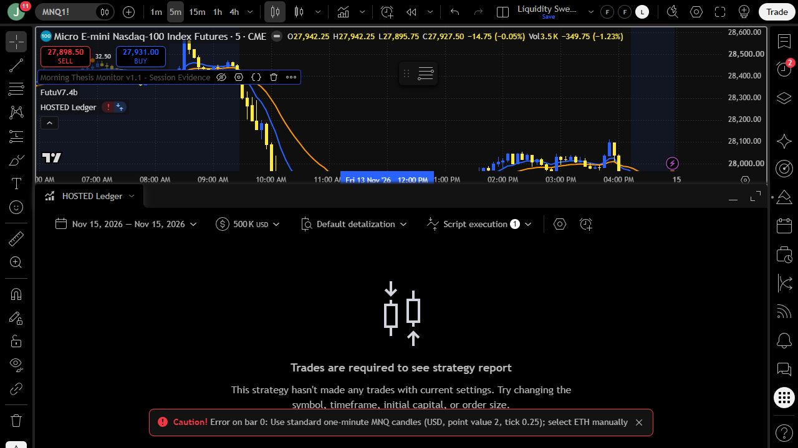
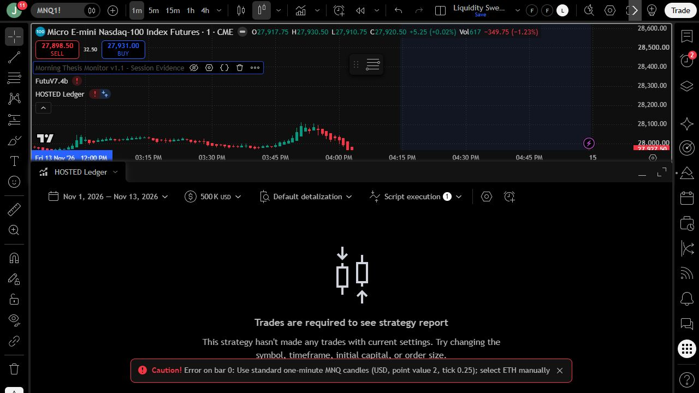
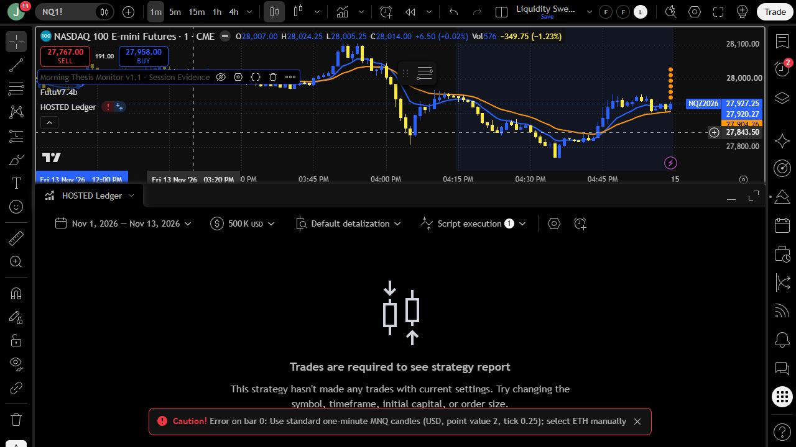
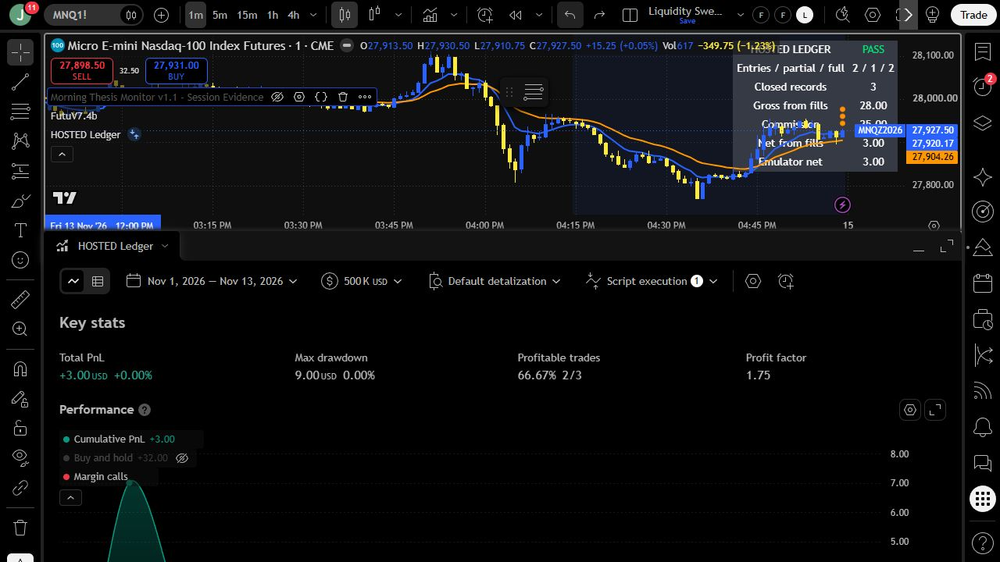

# Hosted accounting chart-guard results - November 15, 2026

## Tested revision and setup

The updated `tests/hosted/accounting_reconciliation.pine` from merged commit
`908d95d0d6e0ae9bd0f676b601907577c78f6483` (PR #15) was pasted unmodified into
TradingView Pine Editor, compiled and added temporarily to Chart #1. Its
SHA256, normalized to UTF-8 with LF line endings, was:

`8ce342a2774c3ce4f34f6d588e426b4f9fac4a71097a827889d8d2a30fe67f5d`

TradingView Pine v6 executed the fixture on CME_MINI:MNQ1! standard one-minute
candles with Electronic Trading Hours and back adjustment enabled. The fixture
kept its default anchor, November 10, 2026, 23:57 America/New_York; the completed
report covered loaded history from November 1 through November 13. The run was
performed on November 15 against historical bars while the market was closed.

Source properties were unchanged: USD 500,000 initial capital, USD 2.50 per
contract per fill, one tick modeled slippage, 100% margin, no pyramiding,
same-close order processing, and no recalculation on fills or every tick.
This is the controlled accounting fixture, not the full production entry model.

## Observed acceptance and rejection cases

| Context | Hosted result | Evidence |
| --- | --- | --- |
| Standard MNQ, 1 minute | PASS; 2 entries, 1 partial exit, 2 full exits, 3 closed records | [Initial PASS](evidence/accounting-guards-valid-nov15.jpg) |
| Standard MNQ, 5 minutes | Rejected on bar 0 | [Timeframe rejection](evidence/accounting-guard-5m-nov15.jpg) |
| Heikin Ashi MNQ, 1 minute | Rejected on bar 0 | [Synthetic-chart error badge](evidence/accounting-guard-heikin-ashi-nov15.jpg) |
| Standard CME_MINI:NQ1!, 1 minute | Rejected on bar 0 | [Wrong-symbol error badge](evidence/accounting-guard-nq-nov15.jpg) |
| Restored standard MNQ, 1 minute | Recovered to PASS; 3 closed records and USD 3.00 emulator net | [Recovery](evidence/accounting-guard-recovery-nov15.jpg) |

The visible accessibility state reported the same fixture error for each
rejected context:

> Error on bar 0: Use standard one-minute MNQ candles (USD, point value 2, tick 0.25); select ETH manually

The five-minute screenshot includes the full error banner. The Heikin Ashi and
NQ screenshots show the selected context and the HOSTED Ledger error badge;
their bar-zero error text was verified through the visible accessibility state
and recorded in the [structured results](ACCOUNTING_GUARDS_2026-11-15.json).
Returning to standard one-minute MNQ cleared the runtime error without editing
the script or its inputs.

## Accounting result and recovery

The updated fixture reproduced the earlier controlled ledger:

| Metric | Hosted result |
| --- | ---: |
| Observed entries | 2 |
| Partial exits | 1 |
| Full exits | 2 |
| Closed records | 3 |
| Gross from fill prices | USD 28.00 |
| Commission | USD 25.00 |
| Net from fills | USD 3.00 |
| Emulator net | USD 3.00 |

The fixture's PASS requires the lifecycle counts and the gross-minus-commission
ledger to reconcile with `strategy.netprofit` within one cent. The recovery run
reproduced PASS and the same net value after the three rejection cases. The
[individual fill ledger from November 11](RESULTS_2026-11-11.md#forced-order-accounting-reconciliation)
provides the earlier trade-by-trade breakdown for the unchanged anchor.

## Coverage limits and cleanup

- These hosted cases establish acceptance of the intended MNQ context and
  rejection of an unsupported timeframe, synthetic candles, and a different
  futures symbol. Currency, point value and tick size were not independently
  falsified while holding every other property valid. The local regression
  suite covers each condition independently; the NQ run alone does not prove
  each metadata condition independently.
- ETH, back adjustment and strategy Properties still require manual inspection;
  the guard does not enforce those settings. Historical assertions do not
  establish live forward behavior or Bar Replay equivalence.
- **External receiver testing remains UNVERIFIED**, including durable
  deduplication, expired-alert rejection, authentication, retries, delivery and
  broker fill reconciliation. No trading-performance improvement is claimed.
- The temporary HOSTED Ledger instance was removed. The original MNQ one-minute
  hollow candles, two-chart split, monitor visibility, watchlist and strategy
  report were restored. No alerts or broker orders were created, and the
  verification run changed no repository files.

The [structured record](ACCOUNTING_GUARDS_2026-11-15.json) contains the tested
commit, fixture digests, contexts, results, screenshot paths and limits. Its raw
byte digest describes the original Windows checkout; the LF-normalized digest
above is the portable source identity.
